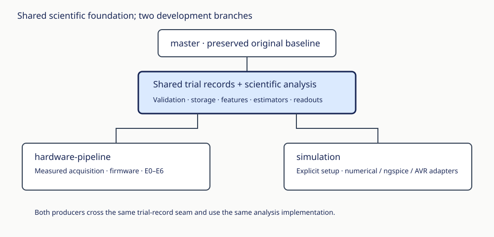

# Plasma reservoir · simulation

Numerical circuit studies with recorded settings and shared scientific analysis. The original Alejandro/Mahault `master` is preserved at `908c168`. This branch and its [sibling](https://github.com/mahault/plasma-reservoir/tree/hardware-pipeline) descend from the same reviewed shared-foundation commit `f344afb`.

```bash
python -m pip install -e '.[dev]'
python -m experiments.ne2.s2_sim_reservoir --help
python -m pytest -q
```

Run commands from this checkout. Select the intended conda/virtual environment before installation. Raw data, private configuration and generated sessions stay local.

- [Workflow guide](docs/simulation.md)
- [Equations, units and interpretation](docs/mathematics.md)
- [Architecture and record contract](docs/architecture.md)
- [Audit corrections and remaining limits](docs/review.md)
- [Terminology](GLOSSARY.md)



The new code separates instantaneous reconstruction from past-input memory, preserves capture integrity/calibration evidence, aligns GP training and prediction, and shares trial analysis across producers. Numerical models and finite-time contraction diagnostics do not prove physical NE-2 computation. Compare real measurements against controls; see the documented Unknowns.

New branch commits use neutral author and committer metadata; this does not remove identities already published on older remote branches or anonymize GitHub push records. Original source credits remain preserved.

Validation: **114 tests passed**, including ngspice and UNO/simavr checks. The seeded noiseless-GP regression emits two sklearn optimizer-bound convergence warnings; these are reported rather than interpreted as physical validation. Both branch wheels build successfully; numerical import isolation was checked from a fresh installed wheel. Public documentation links were checked, and the shared scientific implementations are byte-identical between branches.
