# How the plasma reservoir works

**Input → neon-lamp circuit → measurements → features → trained readout.**

The input changes the voltage of a biased NE-2 lamp circuit. Its response depends on the input and recent history. We record that response, then train a readout to reconstruct past inputs or predict a task target. The lamp is useful for a task only if the complete procedure performs better than the stated controls.

This document explains the system and its maths. [simulation.md](simulation.md) explains how to run the numerical version. Installation and commands are in the branch [README](../README.md).

## 1. System overview


[Editable diagram](figures/system_overview.html)

The diagram shows functions, not a verified construction schematic. The selected board is Teensy 4.1; UNO support is retained. The board plays held steps and sine waves. Physical speech currently comes from laptop audio; Teensy SD/streamed speech playback is not implemented.

| Part | What it does |
|---|---|
| Supply $V_s$, filter $R_f,C_f$, charging resistor $R_s$ | Bias the node and limit charging current. |
| Input resistor $R_e$ and coupling capacitor $C_c$ | Inject the signal while blocking steady DC through the input branch. |
| Node capacitor $C$ and NE-2 bulb | Store charge; the discharge changes the node response nonlinearly. |
| Photodiode, $R_{sense}$ and node divider | Measure light, bulb current and node voltage. Buffers, protection and anti-alias filters condition those signals. |
| Board and host | Generate supported stimuli, sample the sensors, timestamp flashes and save each trial with its settings. |

**Key terms:** a *state* describes the circuit's internal condition; an *observable* is something measured; a *feature* is a number extracted from those measurements. The *readout* is the trained predictor. *Fading memory* means dependence on older inputs diminishes; *useful memory* must also be recoverable from the recorded features. See the short [glossary](../GLOSSARY.md) for remaining terms.

### Input and data sources

- **Held steps:** the host and firmware share a seeded generator. For 8-bit level $l_k$, $u_k=(l_k-127.5)/127.5$. Save levels, seed and hold time so the input is known independently of the response.
- **Sine waves:** generated by the board for link and bandwidth checks; use the frequency implied by its digital phase increment.
- **Speech:** local recordings or an optional FSDD corpus. Physical E5 plays laptop audio and logs a source-side tap. Simulation can inject the waveform, RMS envelope or masked band features. State the chosen encoding and scaling.
- **Responses:** physical ADC counts/events come from sensors; simulated counts/events come from model assumptions. Legacy CSV timestamps are not logged voltage inputs.
- **Targets:** delayed-input functions, NARMA recurrence values or audio labels. Targets are generated from the known input/labels, not extra plasma measurements.

## 2. What the circuit remembers

At rest, the supply charges the node. An input can push it toward breakdown. A discharge drains charge, then the circuit recovers. The two capacitors retain electrical history; residual discharge effects are an additional model hypothesis. A slow internal mode does not automatically provide useful task memory.

### Symbols and units

| Symbols | Meaning | Units |
|---|---|---|
| $V_s,V_{th},v,v_a,v_{in},w$ | Supply, equivalent supply, node, coupling junction, drive and coupling-capacitor voltages; $w=v-v_a$ | V |
| $R_{ch}=R_f+R_s$, $R_d=R_{d1}+R_{d2}$, $R_{th},R_e,r_{on}$ | Charging, divider, equivalent, input and conducting-bulb resistances | $\Omega$ |
| $C,C_c$ | Node and coupling capacitances | F |
| $i_b,j$ | Bulb current and injected input current | A |
| $V_b,V_e,V_{intercept}$ | Breakdown, extinction and conducting-line intercept | V |
| $I_{min},I_{max}$ | Sustaining and permitted maximum currents | A |
| $Y_{bg},Y_{res},\tau_{res},t_f,h$ | Seed rates, residual decay, formative delay and numerical substep | $\mathrm{s}^{-1},\mathrm{s}^{-1},\mathrm{s},\mathrm{s},\mathrm{s}$ |

### Supply, input and state equations

**Derived:** the node divider loads the supply, so

$$V_{th}=V_s\frac{R_d}{R_{ch}+R_d},\qquad R_{th}=\frac{R_{ch}R_d}{R_{ch}+R_d}.$$

The input current is $j=(v_{in}-v+w)/R_e$. Kirchhoff's current law then gives

$$\boxed{C\dot v=\frac{V_{th}-v}{R_{th}}+j-i_b,\qquad C_c\dot w=-j.}$$

The first equation accounts for charge entering/leaving the node. The second tracks charge in the coupling capacitor. Keep measured module voltage $V_s$ separate from equivalent bias $V_{th}$.

### Bulb rule and operating regime

The numerical bulb is an assumed hysteretic switch: accumulate seed hazard above $V_b$, wait a formative delay, conduct with $i_b=(v-V_{intercept})/r_{on}$, and extinguish below $V_e$. Here $r_{on}$ includes sense resistance. Historical simulator field `V_m` means **intercept**, not the maintaining voltage measured at an operating current.

The assumed seed rate after extinction is

$$Y(\tau)=Y_{bg}+Y_{res}e^{-\tau/\tau_{res}}.$$

For constant rate $Y$, the statistical waiting time has mean $1/Y$. Actual NE-2 rates and their dependence on recent discharge need measurement. The implementation does not cancel a scheduled strike if voltage later falls; below-threshold delayed strikes remain an explicit unresolved model behavior.

Near breakdown, the intended rest condition is $V_e<V_{th}<V_b$, with margin $\Delta V=V_b-V_{th}$. It must also extinguish after excitation: supply and charged $C_c$ must not sustain a latched discharge. The voltage inequality alone does not guarantee that.

For the affine conducting model, **derived** steady current and candidate always-on interval are

$$I=\frac{V_{th}-V_{intercept}}{R_{th}+r_{on}},$$

$$\max\!\left(V_b,V_{intercept}+I_{min}(R_{th}+r_{on})\right)<V_{th}<V_{intercept}+I_{max}(R_{th}+r_{on}).$$

E0 uses measured slope/intercept when available; otherwise it labels its constant-voltage approximation. These checks are not a physical construction safety certificate.

<details>
<summary><strong>Numerical equations: the exact linear step</strong></summary>

With $x=(v,w)^T$ and bulb off, $\dot x=Ax+b_0+b_uv_{in}$:

$$A=\begin{bmatrix}-(1/R_{th}+1/R_e)/C&1/(R_eC)\\1/(R_eC_c)&-1/(R_eC_c)\end{bmatrix},\quad b_0=\begin{bmatrix}V_{th}/(R_{th}C)\\0\end{bmatrix},\quad b_u=\begin{bmatrix}1/(R_eC)\\-1/(R_eC_c)\end{bmatrix}.$$

Conduction adds $-1/(r_{on}C)$ to $A_{11}$ and $V_{intercept}/(r_{on}C)$ to $b_{0,1}$. Held input over substep $h$ gives

$$x_{n+1}=e^{Ah}x_n+A^{-1}(e^{Ah}-I)(b_0+b_uv_{in}).$$

This is exact for each linear segment with nonsingular $A$. Event detection and readout updates remain discretized. With positive resistances/capacitances, $\operatorname{tr}A<0$ and $\det A=1/(R_{th}R_eCC_c)>0$: off-state modes decay, but this does not prove stability of the whole stochastic switching system. Small steps or ill-conditioned matrices can challenge the matrix integral.

</details>

## 3. From measurements to a saved trial

A0 records the physical audio input tap; A1 light; A2 bulb current; A3 divided node voltage. A comparator path records flash times separately. ADC channels are sampled round-robin, not simultaneously.

For clock $f_c$, timer count $q=\mathrm{ocr1a}+1$, $m$ channels and $N_s$ ticks per input step,

$$T_{tick}=q/f_c,\quad T_{step}=N_sT_{tick},\quad f_{channel}\approx f_c/(qm),\quad t_{flash}=(nq+s)/f_c.$$

Here $n,s$ are whole/sub-tick counts. `ocr1a` is a shared protocol name; Teensy uses CPU-cycle timing, UNO its AVR timer. Counts need the saved ADC reference and sensor gains to become physical quantities. Nominal timing is not a measurement of interrupt/ADC latency.

A trial joins **raw samples/events + known input + timing/calibration + source + run metadata**:

```text
SESSION/
├── bench.yaml       # measured setup snapshot in physical sessions
├── index.csv        # trial metadata and relative raw-file paths
└── raw/TRIAL.npz    # arrays, acquisition metadata, stimulus/setup extras
```

The transport checks CRC, sequence and sample origin before assigning channels; standard recording aborts on loss. Storage preserves drop counts, board/source and known calibration. Duplicate IDs, escaping paths and missing/unindexed files are rejected. Use one writer per session and move complete sessions together. Files publish individually atomically; NPZ plus CSV is not a database transaction.

Legacy missing drop status stays unknown. A1/A2 require known zero loss by default; `--allow-legacy` permits unknown historical status, not known loss. It cannot restore missing inputs, calibration or controls. Physical records retain bulb, regime, control, repeat, temperature, warmup, measured supply and jumper state. S2 synthetic records retain circuit/profile/seed/substeps and do not invent a measured supply.

## 4. From trials to results



[Editable diagram](figures/data_flow.html)

### Features and trained readout

The standard per-step features are

$$x_k=[\overline{A1}_k,\overline{A2}_k,\overline{A3}_k,N_{flash,k},\Delta t_{last,k}].$$

These are three mean ADC readings, flash count and the last inter-flash interval in seconds (zero before two flashes). The audio-only capacity control uses A0 as its analog feature. Every requested channel must have samples in each window. Virtual nodes split a step into sub-windows; report that change in readout dimension.

A linear readout predicts $\hat y_k=b+\mathbf{w}^{T}x_k$; only its weights/bias are trained. Bayesian ridge adds predictive uncertainty, and `BayesNetReadout` joins Bayesian ridge nodes in a DAG using parent outputs. Neither uncertainty calibration nor a benefit from the graph is automatic. The GP digital twin is a separate fitted input-history surrogate needing held-out validation.

### Capacity: current input versus past input

For target $z$, least-squares capacity is

$$C[z]=1-\frac{\min_{\mathbf w}\langle(z-y_{\mathbf w})^2\rangle}{\langle z^2\rangle}.$$

Targets are products of normalized Legendre functions $\sqrt{2n+1}P_n(u)$ at chosen delays, orthonormal for continuous iid $u\sim U[-1,1]$. The implementation uses an SVD readout span with intercept, shuffled-input cutoff and Richardson correction $2C_N-C_{N/2}$; retained terms are clipped to $[0,1]$.

| Output | Meaning |
|---|---|
| `instantaneous_linear` | Degree-one reconstruction at delay 0. |
| `mc` | Degree-one reconstruction at strictly positive delays. |
| `nonlinear` | Higher-degree reconstruction. |
| `total` | All retained terms, including delay 0. |

A memoryless $x_k=u_k$ can score about 1 instantaneously and about 0 for past-input MC. The 256-level drive only approximates continuous-uniform orthogonality. The finite-data correction/cutoff is not a calibrated confidence interval or an automatic population-rank bound. See [Dambre et al.](https://doi.org/10.1038/srep00514) for the capacity framework.

### Repeatability and task performance

Consistency is mean pairwise Pearson correlation for the same common drive; constant traces are undefined. Analysis checks drive, conditions, source, timing and calibration compatibility. Flash matching consumes unused nearest events in reference order within a tolerance; it prevents reuse but is greedy, not globally optimal.

The contraction diagnostic fits $\log d(t)\approx a+\lambda_{fit}t$. A negative finite-time slope means contraction over that interval, not proof of a largest asymptotic Lyapunov exponent or echo-state property. Matching noise seeds couples draws by event index, which becomes subtle when event histories differ.

For NARMA-10, $u_t\in[0,0.5]$ and

$$y_{t+1}=0.3y_t+0.05y_t\sum_{i=0}^{9}y_{t-i}+1.5u_{t-9}u_t+0.1.$$

State $x_k$ predicts $y_{k+1}$. S6 fits scaling on training rows, keeps a chronological test segment, and selects ridge penalty by training-only leave-one-out CV (not forward-chaining). Speech uses file labels and its documented splits in [simulation.md](simulation.md#speech-and-other-studies).

Report regression $\mathrm{NMSE}=\mathrm{MSE}/\operatorname{Var}(y)$ (infinite for constant targets under this implementation), or classification accuracy. Mean ± std is descriptive; A3's nonoverlap rule is not a formal significance test.

### Required comparisons

Use comparable inputs, preprocessing, splits and tuning when comparing bulb features with input-only features, a physical resistor control or a numerical bulb-removed RC circuit, and shuffled-input capacity. Identify which control was used: the removed-bulb model is not the physical resistor-in-socket circuit. Nonlinearity, recoverable memory and task accuracy answer different questions.

## 5. Where the code runs

| Location | Responsibility |
|---|---|
| `stimuli.py`, `encoding.py` | Known drive generation and audio encoding. |
| `acquisition/`, `firmware/` | Physical configuration, stimuli, transport and recording; optional firmware replay uses shared transport. |
| `trials/` | Validated captures, metadata, portable storage and discovery. |
| `characterization/`, `analysis/` | Features/estimators and trial-level alignment, checks and grouping. |
| `readout/`, `evaluation/`, `benchmarks/` | Trained predictors, metrics and task targets. |
| `reservoir/` | Historical interface/CSV loader, GP surrogate and unimplemented live-hardware stub. |
| `simulation/` | Explicit numerical configuration/model and optional ngspice/AVR adapters. |
| `experiments/ne2/` | E-series physical runs, S-series simulations and shared A-series analysis commands. |

`hardware-pipeline` supplies physical commands; `simulation` supplies numerical studies; original `master` preserves the Alejandro/Mahault code. Run commands from the branch containing them. Keep shared record/analysis definitions synchronized. Use E-series commands for hardware, not the historical live stub.

**Bench order:** E0 component/operating checks → E1 zero-loss link → E2 bulb-free input path → E3 bandwidth → E4 capacity / E5 speech / E6 common-drive repeats → A1–A3 analysis. Retain measured settings, controls and repeated trials across bulbs. Both branch READMEs give installation and exact entry points.

## 6. Evidence and remaining limits

Tests check record/transport integrity, alignment, features and estimator regressions. The analytical linear case, ngspice comparisons and UNO replay check particular numerical/circuit/firmware assumptions. Teensy compilation checks a build, not measured hardware timing.

Actual NE-2 delay, optics, stray capacitance, ageing/temperature effects and acquisition latency still need calibration. Scheduled-strike semantics, physical always-on discharge behavior, finite-data uncertainty and asymptotic Lyapunov claims remain limited. Report each result as measured, derived, simulated or hypothesized; a model result is not physical evidence.

**Hardware references:** [PJRC Teensy 4.1](https://www.pjrc.com/store/teensy41.html) specifies 3.3 V pins without 5 V tolerance. The [scanned NE-2AS catalogue page](https://w140.com/tekwiki/images/e/e6/Neon_lamp_specifications.pdf#page=2) lists breakdown 60/76/90 V (min/average/max), maintaining 58 V at 0.3 mA and design current 0.3 mA under stated conditions; those are not measurements of this bulb. Before energized work, establish measured voltage/current, current limiting, protection and component/probe ratings; disconnect and discharge before rewiring. No example here supplies a universal safe setting.
