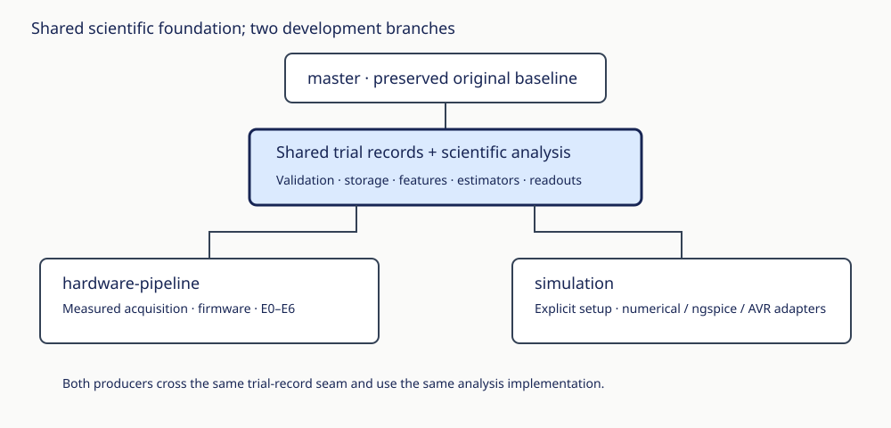

# Hardware and simulation structure

The original `master` stays at `908c168`. The two development branches share an identical foundation commit containing trial records, scientific estimators, trial analysis, readouts, tests and these explanations. Workflow commits add physical acquisition or numerical studies. Backport fixes to common files deliberately between the branches; do not independently redefine their mathematics.

| Deep module | Interface callers use | Implementation it owns |
|---|---|---|
| `plasma_rc.trials` | `Capture`, `RunMeta`, `write_trial`, `load_trial`, `trials` | Shape/timing/calibration validation, integrity evidence, versioned portable storage, duplicate protection. |
| `plasma_rc.simulation` | Explicit `AcquisitionProfile`, `SimulationSetup`, circuit and adapter functions | Numerical flow, immutable settings, seeded runs; optional ngspice and AVR adapters. Present on simulation branch. |
| `plasma_rc.analysis` | `ipc.analyse`, `dynamics.analyse`, virtual-node extraction | Record discovery, integrity gates, alignment, repeat compatibility, feature extraction and estimator orchestration. |

Hardware and numerical simulation are two real adapters at the record seam. Depth comes from the leverage of one validated record/analysis interface for both producers. Locality puts integrity fixes in one implementation. Under the deletion test, removing record/storage or shared analysis would spread their rules among every experiment; merely moving the old dataclass would not earn that depth.

Scientific estimators remain separate in `characterization/`; small files are not by themselves a reason to merge distinct mathematical definitions. `experiments/ne2/a1_ipc.py` and `a2_dynamics.py` handle command arguments/output and call shared analysis. They are no longer imported as analysis libraries. Commands are run as modules from the repository root.

## Record contract

New records use schema 1: `raw/<trial>.npz` plus a relative path in `index.csv`. Samples, events, drop counters, clock, timer, board, source and available ADC calibration survive round trips. Unknown reference voltage is stored as unknown, not a nominal measured value. Synthetic records include their full setup and seed; measured module voltage remains unset for simulations.

A session supports one writer. Trial names cannot escape the session and duplicate IDs fail before replacement. Files publish atomically; NPZ plus CSV is not a multi-file database transaction. Failures during index publication remove the newly published unindexed raw file without changing prior records. Discovery reports incomplete/missing/unindexed records. Keep backups; do not run concurrent writers into one session.

Legacy NPZ files load with `dropped=None` when the original file lacks that evidence. A1/A2 accept them only with `--allow-legacy`; this does not restore missing calibration or make a dropped capture valid. Move complete sessions together. Deliberately reject unknown schemas and incompatible repeat timing/calibration.

`bulb_model.py`, `sim.py` and acquisition imports retain compatibility names for existing consumers; new code imports the specific module. Numerical simulation does not need serial/audio dependencies. Optional firmware replay imports the transport codec only when that adapter is selected.
