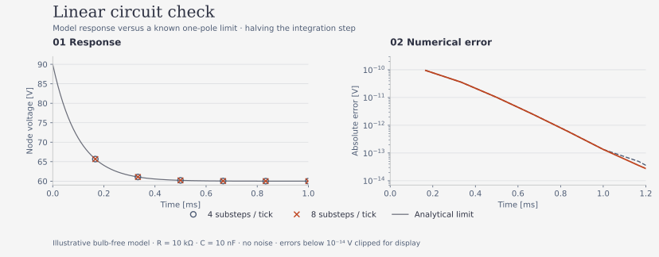

# Equations and interpretation

**Derived** equations below follow KCL and the implemented affine model. **Cited** identifies an external source. **Assumed/Unknown** identifies uncalibrated device behavior. Numerical correctness of a model is separate from evidence that a physical NE-2 computes.

## Circuit state and units

| Symbol | Definition | Units |
|---|---|---|
| V_s, V_th | Module supply; equivalent supply seen at node | V |
| R_ch, R_d, R_th | Charging resistance; divider total; equivalent resistance | ohm |
| v, w | Node voltage; coupling-capacitor voltage v-v_a | V |
| v_a, v_in | Coupling junction voltage; external drive source | V |
| C, C_c | Node and coupling capacitance | F |
| R_e, r_on | Input resistance; conducting bulb slope including sense resistor | ohm |
| i_b, j | Bulb current; current injected into node | A |
| V_b, V_e, V_intercept | Breakdown, extinction, affine conducting intercept | V |
| Y_bg, Y_res | Background and residual seed rates | s^-1 |
| tau_res, t_f, h | Residual decay, formative delay, integration substep | s |

The supply reduction is

$$V_{th}=V_s\frac{R_d}{R_{ch}+R_d},\qquad R_{th}=\frac{R_{ch}R_d}{R_{ch}+R_d}.$$

This assumes the supply filter can be represented by that equivalent; ngspice retains the explicit filter for comparison.

With $j=(v_{in}-v+w)/R_e$ and $w=v-v_a$, KCL gives

$$C\dot v=(V_{th}-v)/R_{th}+j-i_b,\qquad C_c\dot w=-j.$$

In the off state, $i_b=0$ and $x=(v,w)^T$ obeys $\dot x=A x+b_0+b_u v_{in}$ with

$$A=\begin{bmatrix}-(1/R_{th}+1/R_e)/C&1/(R_e C)\\1/(R_e C_c)&-1/(R_e C_c)\end{bmatrix},\quad
b_0=\begin{bmatrix}V_{th}/(R_{th}C)\\0\end{bmatrix},\quad
b_u=\begin{bmatrix}1/(R_e C)\\-1/(R_e C_c)\end{bmatrix}.$$

For positive resistances/capacitances, $\operatorname{tr}A<0$ and $\det A=1/(R_{th}R_e CC_c)>0$, so each off-state linear mode decays. This alone does not prove global stability of the switching stochastic system.

On-state current is $i_b=(v-V_{intercept})/r_{on}$. The simulator's historical field `V_m` means that intercept, not a measured maintaining voltage. It adds $-1/(r_{on}C)$ to $A_{11}$ and $V_{intercept}/(r_{on}C)$ to $b_{0,1}$.

For held input over h, the implemented flow is

$$x_{n+1}=e^{Ah}x_n+A^{-1}(e^{Ah}-I)(b_0+b_u v_{in}).$$

This is exact between events for nonsingular A; switching times and readout filtering are discretized. ADC labels now refer to the same nominal tick as the integrated sample. Physical interrupt/ADC latency has not been measured. For extreme conditioning or tiny steps, cancellation in the matrix integral remains a numerical concern.

The figure uses an explicitly bulb-free circuit with stated illustrative parameters, no measurement data. Regenerate from the simulation branch with `python docs/figures/linear_response.py`. It compares the exact one-pole limit and two integration resolutions; a small error validates that setup only.

## Switching and operating conditions

The adopted hypothesis schedules a seed event above $V_b$, using rate $Y(\tau)=Y_{bg}+Y_{res}e^{-\tau/\tau_{res}}$, followed by a nonnegative Gaussian formative delay; on-state ends below $V_e$. The existing implementation does not cancel a scheduled strike if voltage falls meanwhile. A regression documents a below-threshold delayed strike. Its physical validity is Unknown; this refactor does not invent a cancellation law.

For an affine on-state and DC-blocked input, steady current is

$$I=(V_{th}-V_{intercept})/(R_{th}+r_{on}).$$

An always-on candidate interval is

$$\max(V_b,V_{intercept}+I_{min}(R_{th}+r_{on}))<V_{th}<V_{intercept}+I_{max}(R_{th}+r_{on}).$$

Startup/hysteresis and device ratings still need separate checks. E0 uses measured slope/intercept when supplied; otherwise it labels its constant-voltage approximation explicitly. Never treat an unknown slope as a measured zero.

## Capacity and task evaluation

For continuous iid $u\sim U[-1,1]$, normalized polynomials are $\sqrt{2n+1}P_n(u)$. Targets are their products across stated delays. **Cited:** Dambre et al. (2012), *Scientific Reports* 2, 514, [published paper](https://doi.org/10.1038/srep00514).

For target z, $C[z]=1-\min_w\langle(z-y_w)^2\rangle/\langle z^2\rangle$. The implementation projects onto the readout span via SVD, including an intercept, applies its existing shuffled cutoff and Richardson correction, and clips each corrected capacity to [0,1]. These finite-data corrections do not by themselves certify a confidence level or enforce a population rank bound. The 256-level DAC distribution only approximates continuous-uniform Legendre orthogonality.

Report instantaneous degree-one capacity at delay 0 separately. **MC sums strictly positive delays.** Total IPC retains delay-zero and nonlinear contributions. A memoryless state x(k)=u(k) must report instantaneous capacity approximately 1 and MC approximately 0. Historical figures that called their sum MC are not directly comparable to this convention.

For NARMA-10, $y_{t+1}=0.3y_t+0.05y_t\sum_{i=0}^9y_{t-i}+1.5u_{t-9}u_t+0.1$, with $u\in[0,0.5]$. State x(k) predicts y(k+1). Scaling is fitted on training steps; the final test segment is held out chronologically. Existing RidgeCV selects its penalty within training using leave-one-out, not forward-chaining folds.

NMSE=MSE/Var(target); it is infinite for a constant target under the existing metric convention. Mean ± standard deviation is descriptive, not a hypothesis-test p-value. A3's nonoverlap heuristic must be read that way.

## Repeat diagnostics

Consistency is mean pairwise Pearson correlation over repeated common-drive responses. Constant traces have undefined correlation. Flash reliability matches unused nearest events in reference order within a tolerance; only complete repeat groups consume events. This deterministic greedy matching prevents reuse but is not globally optimal event assignment.

The replica calculation fits a slope to log distance over a finite interval. A negative slope indicates contraction there; it does not establish a largest asymptotic Lyapunov exponent or prove the echo-state property. Simulated equal seeds couple draws by event index; diverging event histories complicate the common-noise interpretation. The bulb-free eigenvalue regression validates the linear special case only.
