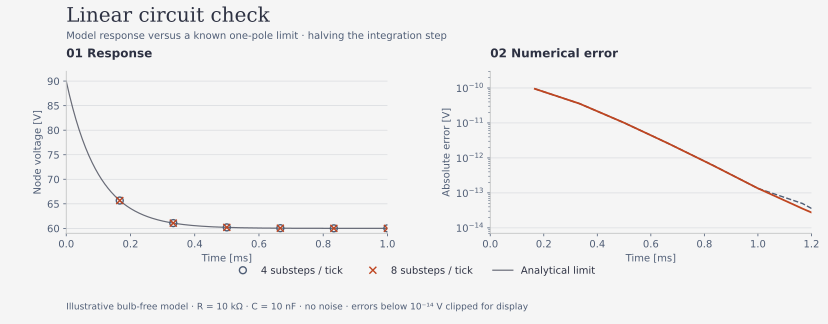

# Running and understanding the simulation

The simulator applies a known input to the circuit equations in [architecture.md](architecture.md), adds the assumed bulb/measurement behavior, and produces synthetic ADC samples and flash times. S2 saves those in the same trial format used by hardware. This tests a model; physical conclusions still require measurements and controls.

## Start with a small run

On the **simulation branch**, from its checkout root, use Python 3.10+:

```bash
python -m pip install -e '.[dev]'
```

No board, dataset, ngspice or Arduino tools are needed for this example:

```python
from plasma_rc.simulation.config import TEENSY41, SimulationSetup, circuit
from plasma_rc.stimuli import xorshift32_levels

profile = TEENSY41
setup = SimulationSetup(circuit(profile=profile), profile, seed=4)
capture = setup.run(xorshift32_levels(seed=7, n=20))
print(capture.source, capture.board, len(capture.values), len(capture.flash_tick))
```

The input seed fixes the drive; the setup seed controls model randomness. This short run stays in memory and is too small for reliable IPC. The GP digital twin is a different fitted surrogate, not this equation-based model.

## Settings and assumptions

`simulation/config.py` defines immutable board profiles and builds the circuit. Pass the **same profile** to `circuit` and `SimulationSetup`; the interface does not prevent independently supplied settings from disagreeing.

| Nominal setting | Teensy 4.1 | UNO |
|---|---:|---:|
| Clock / `ocr1a` | 600 MHz / 24999 | 16 MHz / 2665 |
| Tick rate | 24000 Hz | approximately 6001.5 Hz |
| Ticks per step / step duration | 480 / 20 ms | 120 / approximately 19.995 ms |
| Integration substeps per tick | 4 | 16 |
| ADC bits / reference | 12 / 3.3 V | 10 / 5 V |
| Assumed drive peak | 1.65 V | 2.5 V |

These are model profiles, not board measurements. Each channel is sampled once per channel cycle. The base rest margin is 0.5 V; sustaining current, capacitances, seed rates and readout gains remain illustrative/assumed. Device/equation meanings are in architecture.md.

To halve the integration step, keep the input/noise seeds and circuit fixed and double `oversample`:

```python
finer = SimulationSetup(setup.circuit, profile, seed=4,
                        oversample=2 * profile.oversample)
```

The model uses exact matrix-exponential flow between switches, but events/filter updates stay on the substep grid. A new parameter regime needs its own convergence check for flash timing, capacity or task error. The scheduled-strike rule can still fire after voltage falls below threshold; optics, delay physics and physical latency are not identified from actual NE-2 measurements.

## Full capacity study and saved data

```bash
python -m experiments.ne2.s2_sim_reservoir --help
python -m experiments.ne2.s2_sim_reservoir \
    --board teensy41 --out results/study-01
```

The full sweep is substantial. Choose a **new** output directory: existing paths are refused. Without `--out`, a timestamp-suffixed directory is created and printed.

S2 compares `linear` (bulb removed), `switch` (no delay), `delay` (no residual term), and `delay+memory`. Capacity runs use 1500 steps and five seeds per condition. Replica runs use five repeats with 100 distinct-prefix and 300 common-drive steps, plus silence. Four virtual nodes, parameter sweeps and a two-seed dt comparison are also included.

```text
results/study-01/
├── summary.json
├── e4/          # capacity trials: index.csv + raw/*.npz
├── e6/          # common-drive replicas and silence
├── sweeps/
└── dt/
```

Each S2 trial retains input levels, timing, circuit/profile, seed and substeps. Its source is simulation; equivalent `V_th` is not falsely stored as measured supply voltage. Move complete sessions together.

```bash
python -m experiments.ne2.a1_ipc results/study-01/e4 \
    --out results/study-01/ipc.csv
python -m experiments.ne2.a2_dynamics results/study-01/e6 \
    --out results/study-01/dynamics.csv
python -m experiments.ne2.s6_sim_narma --session results/study-01/e4
```

A1/A2 use saved timing and reject incompatible/lost records. Read `instantaneous_linear`, positive-delay `mc`, `nonlinear` and `total` separately. S6 maps $u$ to $(u+1)/4$ in $[0,0.5]$, trains aligned rows 100–999 and tests from 1000 onward, using training-only scaling/RidgeCV. Its references are current input, a 10-tap delay line and that delay line with products. Output is `results/sim_narma.json`; later runs overwrite this aggregate filename.

## Speech and other studies

| Study module | Input / output | Additional needs |
|---|---|---|
| `s1_sim_evidence` | Circuit/firmware checks → `results/sim_evidence.json` | ngspice and/or Arduino/gcc/simavr for the selected checks. |
| `s3_sim_breakdown` | Assumed ramp/delay study → `results/sim_breakdown.json` | Numerical installation. |
| `s4_sim_lyapunov` | Finite-time replica slope → `results/sim_lyapunov.json` | Numerical installation; filename does not make it a proven asymptotic exponent. |
| `s5_sim_audio`, then `s5_audio_readout` | Local audio → `results/sim_audio/` features/readout results | Compatible `data/Data` corpus; optional `.[audio]` dependencies and ffmpeg for MP3. |

Run a module with `python -m experiments.ne2.<name>`. S3/S4 create the results directory but replace their fixed aggregate filenames on later runs. The firmware adapter needs the checked-out UNO sketch/harness, not just an installed wheel. No Teensy timing simulator is supplied.

Speech input follows the directory/label rules in `acquisition/audio_tree.py`; scripts do not download data. S5 compares raw waveform, RMS envelope and masked band features using corpus/encoding scaling. Its audio configuration assumes 100 pF and a 0.25 V margin, not measured stray capacitance or a hardware recommendation. Record the scaling policy when interpreting splits.

S5 saves study-specific aggregate features and local intermediate groups, not E4/E6 raw captures. FSDD evaluation selects sample indices 0–4 as test; other tasks use fixed stratified folds and training-set scaler/ridge fitting. Inspect required speakers/classes before changing the corpus. Missing groups are not completed comparisons; only load trusted local pickle/object-array artifacts.

## Check numerics and report the result

```bash
python -m pytest -q
python docs/figures/linear_response.py
```



The figure compares a bulb-free one-pole limit at two substep resolutions. Noise is disabled: its five seeds are not independent uncertainty samples. Optional external-tool tests skip when unavailable; check the summary before claiming those checks passed. Teensy build checks on the hardware branch do not replace E1 measurements.

Keep input/noise seeds, circuit/profile, substeps, features, controls, split, score and output location with every result. Agreement with ngspice or the analytical example validates the chosen approximation only. A negative finite-time slope is not a Lyapunov proof; a shuffled capacity cutoff is not a confidence interval; a simulated bulb-removed network is not the physical resistor control. Old charts used different MC/timestamp conventions and must be recomputed before being presented as corrected results.
