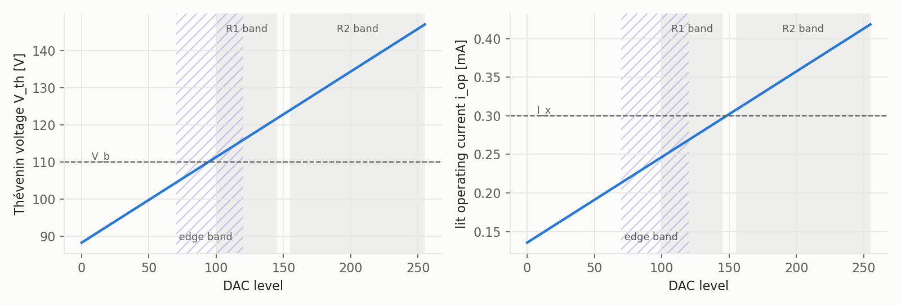
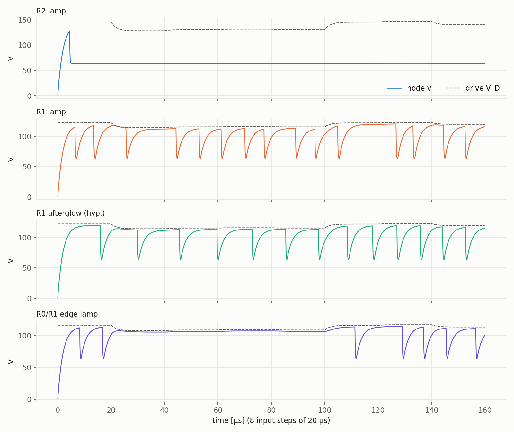
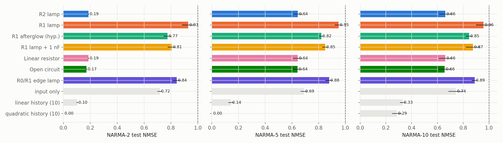
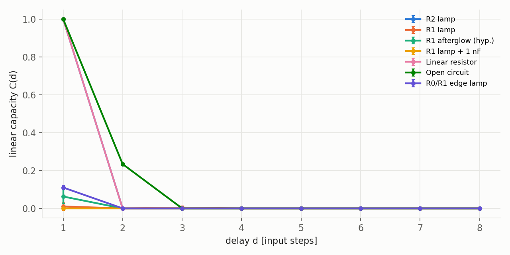
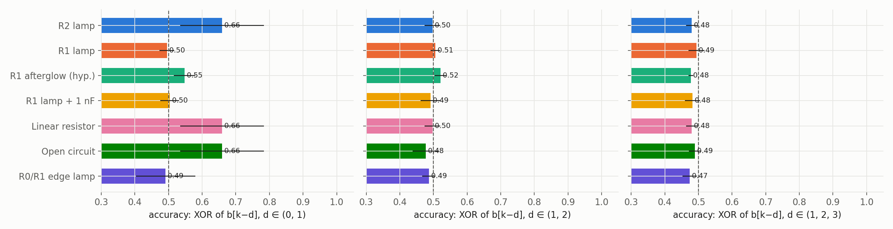
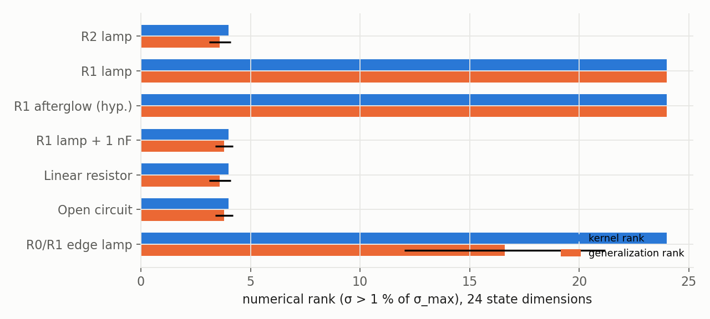
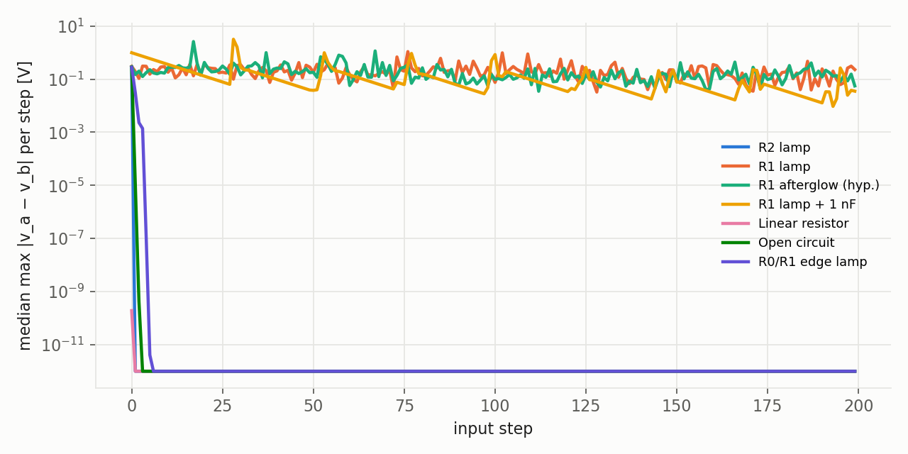
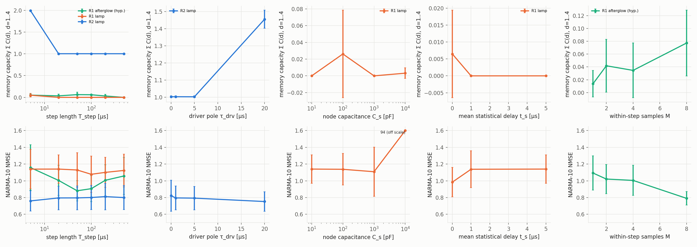

# Method-validation study: can the minimal neon-lamp circuit compute? (simulation, 2026-11-04)

> **Status: SIMULATION (SIM-01). Not lamp evidence.** Every number below comes from the event-driven model of the
> minimal circuit with an *illustrative* parameter set (`configs/sim_illustrative.json`, values tagged *assumed*,
> not NE-2H). The model lamp is a memoryless switch (the N-A surrogate) unless labelled *hyp.* The study tests
> whether the **circuit, the benchmarks and the analysis** behave correctly before bulbs arrive; it cannot show
> that a real NE-2H computes.

## 0. Summary

| Question | Answer from this study | Label |
|---|---|---|
| Do the benchmarks give false positives on systems that cannot compute? | **No.** The linear resistor, the open circuit and the memoryless lamp never beat the input-history baselines on any task; attribution Δ ≈ 0 for all of them. | Derived (measured in sim) |
| Does a lit lamp (regime R2) add anything over a resistor? | **Not in this model.** R2 lamp and linear resistor give identical numbers on every metric. In the model a lit lamp *is* a linear resistor, so any R2 hardware gain over the resistor control would have to come from lit-state physics the model lacks. | Derived |
| Does a free-running relaxation oscillator (R1) compute? | **No.** It lacks the echo-state property (twin trajectories never converge in 200 steps), its states do not repeat across noise realizations (κ ≈ −1), and its NARMA errors are worse than using the input alone. Making the strike delay deterministic does not rescue it: the oscillation phase is the problem. | Derived |
| Would the pipeline see lamp memory if it existed? | **Only weakly in R1.** A hypothetical afterglow lamp gave Δ ≈ 0 (undetected); only its flash counts carried a little information (NARMA-10 0.85 vs 1.01). The protocol as configured is **insensitive** in R1. | Derived |
| Where should the hardware operate? | **At the strike threshold (R0/R1 edge).** It is the only lamp condition with the echo-state property *and* input-structured states (generalization rank 16.6 < kernel rank 24). It is still noise-limited at 20 µs steps. | Derived, with Inferred recommendation |
| Is NARMA-10 the right benchmark for one lamp? | **Not alone.** It needs ~10 steps of memory; a 10-tap quadratic history scores 0.29 without any physics. Use the battery in §12: MC/IPC, NARMA-2/5/10 with baselines, delayed XOR, kernel vs generalization rank, consistency, twin divergence, and the E2 pulse-pair test. | Derived + Cited |

**Bottom line.** The analysis pipeline is trustworthy in one direction: it does not invent computation. It is not yet
sensitive enough in the other: the window-mean readout at 20 µs steps would miss a realistic lamp memory in R1.
The two highest-value changes before hardware are (1) operate at the R0/R1 edge, and (2) add **strike-latency
features** (time of first strike after each step onset), because gas memory acts on the strike delay directly
(Spasić et al. 2003). Both are proposals, not yet decisions.

---

## 1. What was simulated

### 1.1 Circuit (CIRC-01/03, one design for sim and hardware)
Single series loop: drive $V_D = V_\text{bias} + G\,x$ → driver output impedance $Z_o$ → ballast $R_B$ → node N2
(stray $C_s$, divider $R_d$) → lamp → sense resistor $R_S$ → return. No added capacitor (CIRC-02). Full
derivation in `docs/technical.md`. Node equation (lamp state $s\in\{0,1\}$):

$$
\begin{aligned}
C_s \frac{dv}{dt} &= \frac{V_D - v}{R_B'} - \frac{v}{R_d} - s\,\frac{v - V_m}{r_\text{on} + R_S},\qquad R_B' = R_B + Z_o\\
\tau_\text{drv}\frac{dV_D}{dt} &= V_\text{cmd} - V_D
\end{aligned}
$$

Lamp: off → on a strike delay $t_d = t_f + t_s$ after $v$ crosses $V_b$ ($t_s\sim\text{Exp}$, mean 5 µs); on → off
when $i_L = (v-V_m)/(r_\text{on}+R_S) < I_x$. With i.i.d. delays this lamp is history-free: it is the N-A
surrogate (NULL-01).

### 1.2 Parameters (all *assumed*, illustrative, not NE-2H)
$R_B$ 200 kΩ, $Z_o$ 1 kΩ, $R_d$ 10 MΩ, $R_S$ 1 kΩ, $C_s$ 10 pF, $\tau_\text{drv}$ 2 µs, $V_\text{bias}$ 90 V,
$G$ 60 V, $V_b$ 110 V, $V_m$ 60 V, $r_\text{on}$ 10 kΩ, $I_x$ 0.3 mA, $t_f$ 1 µs, $\bar t_s$ 5 µs. DAC level
$\ell\in[0,255]$, $x=\ell/255$.

### 1.3 Integration
scipy `solve_ivp`, Radau with exact Jacobian, between events; strike and extinction found by terminal event
detection; `rtol` 1e-8, `atol` 1e-9. **Tolerance check:** rerunning the R1 lamp (seed 0) with `rtol` 1e-10 gave
identical NARMA-10 (0.9340) and flash rate (1.825/step). Results are not solver artefacts.

### 1.4 Input, states, readout (READ-01, VALID-01)
- Input: held random levels in a band, one level per step of length $T$ (default 20 µs), 1000 steps (600 in sweeps).
  Scaled input $s = 4u-1\in[-1,1]$ with $u$ the normalized level in $[0, 0.5]$.
- State per step: $M=4$ sub-windows; in each, the **mean** of node voltage $v$ and sense voltage $v_S$ over 16 fine
  samples → 8 features/step. (Point samples aliased the µs relaxation cycle; window means are also what the
  hardware's linear sub-window averaging delivers.)
- Readout: ridge regression on standardized features; split washout 10 % / train to 50 % / validation to 70 % /
  test 30 %; $\alpha\in\{10^{-6},10^{-4},10^{-2},1\}$ picked on validation, refit on train+validation, scored once on test.
- 5 seeds (0–4) for every condition; mean ± std across seeds.

### 1.5 Conditions (the one variable is the lamp/band; everything else fixed)

| Condition | Level band | Lamp model | What it controls for |
|---|---|---|---|
| **R2 lamp** | 155–255 | i.i.d. delay | lamp held lit (operating current > $I_x$) |
| **R1 lamp** | 100–145 | i.i.d. delay | free-running relaxation oscillation |
| **R1 afterglow (hyp.)** | 100–145 | *hypothetical* memory lamp: $t_d = t_f + t_s e^{-a/8}$, $a$ += 1 per strike, decays with 100 µs | positive control: does the pipeline see lamp memory? |
| **R1 lamp + 1 nF** | 100–145 | i.i.d. | added-capacitor confound (CIRC-02) |
| **Linear resistor** | 155–255 | always-on $r_\text{on}$, $V_m=0$ | negative control: linear, memoryless load |
| **Open circuit** | 155–255 | never strikes | negative control: lamp removed |
| **R0/R1 edge lamp** | 70–120 | i.i.d. | straddles the strike threshold (level ≈ 95): excitable regime |

The edge condition was added after the first run showed that neither pure band works (post hoc, see §14).

---

## 2. Measures and why each one

| Measure | Definition | What it detects | Source |
|---|---|---|---|
| NARMA-n NMSE | predict $y[k+1]$ from state $X[k]$; $\text{NMSE} = \overline{(z-\hat z)^2}/\text{var}(z)$ | joint memory + nonlinearity on a standard task | NARMA-10: Atiya & Parlos 2000 (Cited). NARMA-2/5: same recursion with order n (**Inferred** generalization; exact published NARMA-2/5 forms not verified) |
| Linear memory capacity MC | $C(d) = 1-\text{NMSE}$ for target $s[k-d]$, $d=1..8$; zeroed below a shuffled-input threshold; MC $=\sum_d C(d)$ | how many past inputs are linearly recoverable | Dambre et al. 2012 (Cited) |
| IPC degree 2 | same, for normalized Legendre $P_2(s[k-d])$ and cross products $s[k-i]s[k-j]$ | nonlinear (quadratic) memory | Dambre et al. 2012 (Cited) |
| Consistency κ | $\kappa = 1 - \overline{\text{MSE}_j / \tfrac12(\text{var}\,a_j+\text{var}\,b_j)}$ for two runs with the same input, different prefix and noise | repeatability: is the state a function of the input? (κ = 1 perfect, κ ≈ −1 independent) | project definition (Derived) |
| Attribution Δ | NMSE(state ~ surrogate mean + $s[k]$) − NMSE(… + $s[k-1..k-5]$) | does past input explain the state beyond the memoryless-lamp surrogate? (claim 1, lamp memory) | NULL-01; exploratory, not a calibrated test |
| Delayed XOR / parity | accuracy of thresholded ridge on $b[k-d_1]\oplus b[k-d_2](\oplus\dots)$, binary input at the band edges | nonlinear memory a linear system cannot produce | parity tasks in the real-time-computation framework of Bertschinger & Natschläger 2004 (Cited for framework) |
| Kernel / generalization rank | numerical rank (σ > 1 % σ_max) of centered final states for 40 random inputs (kernel) and 40 small perturbations of one input (generalization) | separation vs noise: computing needs **high kernel, low generalization** rank | Legenstein & Maass 2007 (Cited) |
| Twin-trajectory divergence | same input and same noise seed, node started at 0 V vs 1 V; distance $d_k = \max|v_a-v_b|$ per step | echo-state / fading-memory property; a local Lyapunov-type exponent | Bertschinger & Natschläger 2004; Grigoryeva & Ortega 2018 (Cited) |

The NARMA-n recursion used (n = 2, 5, 10):

```math
y[t] = 0.3\,y[t-1] + 0.05\,y[t-1]\sum_{i=1}^{n} y[t-i] + 1.5\,u[t-1]\,u[t-n] + 0.1
```

**Why "twin divergence" and not a textbook Lyapunov exponent.** The circuit is a hybrid system: smooth flow between
strikes, discontinuous jumps at strikes. A tiny state difference near $V_b$ can make one twin strike and the other
not, so the linearized (tangent-space) exponent is undefined at the events (**Derived**). We therefore measure the
quantity the reservoir property actually needs, i.e. whether the influence of the initial state disappears. We report
the convergence step (first step after which $d_k<1$ µV for good) and, where it does not converge, the slope of
$\ln d_k$ over time as an exponent $\lambda$ [1/s].

**Linear ceiling for XOR (Derived).** With two equiprobable bits, a linear threshold on states that are linear in
$(b_1,b_2)$ classifies at most 3 of the 4 patterns, so accuracy ≤ 0.75. Above 0.75 requires nonlinear memory.

**Baselines (N-B).** The same ridge readout on input-only $s[k]$, a linear history $s[k..k-9]$, and a quadratic history
(the 10 lags + all 55 pairwise products). A reservoir claim (claim 2) needs to beat these, not just score below 1.

---

## 3. Figure 1: operating regimes of the illustrative circuit



**What it shows.** Left: Thévenin voltage at N2, $V_\text{th}(\ell)$, against DAC level, with the breakdown voltage
$V_b$. Right: the lit operating current $i_\text{op}(\ell)$ with the extinction current $I_x$. Shaded: the R1 and R2
bands; hatched: the edge band.

**Reading.** Below level ≈ 95, $V_\text{th}<V_b$: the lamp never strikes (R0, a plain RC). Between ≈ 95 and ≈ 150 it
strikes but cannot stay lit ($i_\text{op}<I_x$), so it relaxes (R1). Above ≈ 150 it stays lit (R2). The edge band
70–120 crosses the R0/R1 boundary, so each step either fires or does not, depending on the input level.

---

## 4. Figure 2: what the node does in each regime



**What it shows.** Node voltage $v$ (colour) and drive $V_D$ (dashed) for 8 steps of 20 µs, same input seed.

**Reading.**
- **R2:** one strike at start-up, then the node sits at the lit voltage ≈ 64 V. A 15 V change in drive moves $v$ by
  well under 1 V. The lamp acts as a voltage clamp; whatever input information survives is a small linear echo.
- **R1:** sawtooth relaxation, ~1.8 strikes per step at irregular times (exponential $t_s$ ≈ recharge time). The
  sub-window means depend on *where in the cycle* each window falls, i.e. on oscillator phase.
- **Afterglow (hyp.):** strikes become more regular in bursts because recent strikes shorten the delay. That is the
  memory, but it shows mainly in strike *timing*.
- **Edge:** fires at high levels and sits silently just below $V_b$ at low levels (20–100 µs). Each silent step
  **resets the oscillator phase**, which is why this regime regains the echo-state property (Fig. 7).

---

## 5. Figure 3: NARMA-2, -5, -10 against baselines



| NARMA test NMSE (mean ± std, 5 seeds) | NARMA-2 | NARMA-5 | NARMA-10 |
|---|---|---|---|
| R2 lamp | 0.186 ± 0.005 | 0.645 ± 0.036 | 0.661 ± 0.051 |
| R1 lamp | 0.927 ± 0.046 | 0.951 ± 0.030 | 0.958 ± 0.058 |
| R1 afterglow (hyp.) | 0.774 ± 0.028 | 0.821 ± 0.018 | 0.846 ± 0.028 |
| R1 lamp + 1 nF | 0.806 ± 0.029 | 0.849 ± 0.022 | 0.875 ± 0.054 |
| Linear resistor | 0.186 ± 0.005 | 0.645 ± 0.036 | 0.661 ± 0.051 |
| Open circuit | 0.171 ± 0.005 | 0.643 ± 0.036 | 0.656 ± 0.049 |
| R0/R1 edge lamp | 0.843 ± 0.032 | 0.880 ± 0.028 | 0.888 ± 0.021 |
| *input only* | 0.717 ± 0.017 | 0.691 ± 0.025 | 0.742 ± 0.057 |
| *linear history (10)* | 0.104 ± 0.007 | 0.145 ± 0.021 | 0.330 ± 0.021 |
| *quadratic history (10)* | 0.000 ± 0.000 | 0.002 ± 0.000 | 0.285 ± 0.036 |

**What it shows.** Horizontal bars = test NMSE (lower is better; the dashed line at 1 = predicting the mean). Grey
bars are the N-B baselines, which use the true input history directly.

**Reading.**
1. **No circuit beats the linear-history baseline on any NARMA order.** Nothing here computes beyond a tapped delay line.
2. R2, linear resistor and open circuit are statistically identical. Their NARMA-2 advantage over input-only
   (0.19 vs 0.72) comes entirely from a one-step echo of $u[k-1]$ (Fig. 4), which is linear and external to the lamp.
3. Every R1 and edge condition is **worse than using the input alone**: the oscillation adds variance unrelated to the
   input. The hypothetical afterglow lamp is better than the memoryless R1 lamp (0.85 vs 0.96 on NARMA-10), so the
   memory is visible *relative to its own surrogate*, but not in absolute terms.
4. NARMA-10 discriminates poorly for a single node: the 10-tap quadratic history reaches only 0.29, the best circuit
   0.66, and the ranking is set by input memory, not by the device. NARMA-2/5 separate conditions more clearly.
   NARMA-10 is also reported to be sensitive to its input range (Kubota et al. 2019 **[preprint, not peer-reviewed]**,
   used only as a caution); we use the standard $u\in[0,0.5]$.

---

## 6. Figure 4: linear memory function C(d)



| Condition | MC $\sum_{d=1}^{8} C(d)$ | IPC degree 2 | consistency κ | attribution Δ | strikes/step |
|---|---|---|---|---|---|
| R2 lamp | 1.000 ± 0.000 | 0.009 ± 0.007 | 1.000 ± 0.000 | −0.000 ± 0.000 | 0.001 |
| R1 lamp | 0.014 ± 0.020 | 0.005 ± 0.010 | −0.964 ± 0.026 | −0.009 ± 0.002 | 1.840 |
| R1 afterglow (hyp.) | 0.063 ± 0.037 | 0.008 ± 0.017 | 0.277 ± 0.494 | −0.001 ± 0.004 | 3.117 |
| R1 lamp + 1 nF | 0.000 ± 0.000 | 0.005 ± 0.010 | −1.389 ± 0.142 | −0.006 ± 0.007 | 0.042 |
| Linear resistor | 1.000 ± 0.000 | 0.009 ± 0.007 | 1.000 ± 0.000 | 0.000 ± 0.000 | 0.001 |
| Open circuit | 1.234 ± 0.002 | 0.005 ± 0.007 | 1.000 ± 0.000 | 0.000 ± 0.000 | 0 |
| R0/R1 edge lamp | 0.110 ± 0.011 | 0.000 ± 0.000 | −0.706 ± 0.042 | 0.001 ± 0.006 | 0.861 |

**What it shows.** Capacity to reconstruct the input $d$ steps back. R2 lies under the linear-resistor line (identical).

**Reading.**
- **The "MC = 1" of the linear systems is a noise-free artefact (Derived).** With $\tau_\text{drv}=0$ (Fig. 8, second
  column) MC is still 1.00, so it is not only the driver pole. The lit node's time constant
  $C_s(R_B'\parallel r_\text{lit})\approx 10\ \text{pF}\times 10.4\ \text{k}\Omega\approx 0.1$ µs leaves a trace of
  order $\tau/(T/M) \approx 2\,\%$ of the previous level in the first 5 µs sub-window mean. Simulated states have no
  noise, so ridge with $\alpha=10^{-6}$ decodes that trace perfectly. A real ADC would bury it. **Consequence:** the
  simulation needs a measurement-noise model before its MC values mean anything, and hardware MC must always be
  compared with the resistor and open-circuit controls measured on the same chain.
- The open circuit keeps more (MC 1.23) because without the lamp load the node τ is $R_B'C_s\approx 2$ µs.
- R1: MC ≈ 0. The input is not linearly recoverable even one step later.
- IPC degree 2 is ≈ 0 everywhere. **No condition produced measurable quadratic memory.**
- κ ≈ −1 (R1, 1 nF) means two runs with the same input are as different as two unrelated runs. The state is not a
  function of the input; it is a function of phase and noise.
- **Attribution Δ ≈ 0 for every condition, including the hypothetical memory lamp.** As configured, the attribution
  test cannot see a memory that acts through strike timing when the readout averages over the timing (§11).

**Ablation: flash counts as the only features** (strikes per sub-window, a nonlinear summary):

| Condition | NARMA-10 NMSE | MC (d=1..4) | IPC2 |
|---|---|---|---|
| R1 lamp | 1.011 ± 0.032 | 0 | 0 |
| R1 afterglow (hyp.) | 0.855 ± 0.035 | 0.011 ± 0.014 | 0 |
| R0/R1 edge lamp | 0.821 ± 0.027 | 0.130 ± 0.020 | 0.002 ± 0.004 |
| R2 / resistor / 1 nF | ≈ 1.01–1.02 | ≈ 0 | ≈ 0 |

Strike events carry the information the window means lose: at the edge, counts alone match the window means on
NARMA-10 (0.82 vs 0.89) and on MC (0.13 vs 0.11). This supports adding **strike-timing features** (Inferred, §13).

---

## 7. Figure 5: delayed XOR / parity



| Accuracy (chance 0.5; linear ceiling 0.75 for 2 bits) | XOR(0,1) | XOR(1,2) | parity(1,2,3) |
|---|---|---|---|
| R2 lamp / resistor / open circuit | 0.659 ± 0.124 | 0.48–0.50 | 0.48–0.49 |
| R1 lamp | 0.495 ± 0.022 | 0.505 ± 0.014 | 0.494 ± 0.024 |
| R1 afterglow (hyp.) | 0.547 ± 0.032 | 0.521 ± 0.018 | 0.477 ± 0.007 |
| R1 lamp + 1 nF | 0.503 ± 0.028 | 0.491 ± 0.029 | 0.483 ± 0.023 |
| R0/R1 edge lamp | 0.491 ± 0.088 | 0.486 ± 0.020 | 0.474 ± 0.021 |

**What it shows.** Binary input (level 5 above the low edge or 5 below the high edge of the band); the readout must
output the XOR of the current and/or past bits.

**Reading.** No condition exceeds the 0.75 linear ceiling, and nothing is above chance once the current bit is
excluded (XOR(1,2), parity). The linear systems' 0.66 on XOR(0,1) is the expected sub-ceiling score of a linear
state containing $b[k]$ and the one-step echo of $b[k-1]$. **Delayed XOR is the cleanest binary test for hardware:**
a score above 0.75 cannot come from any linear chain.

---

## 8. Figure 6: kernel rank vs generalization rank



| Condition | kernel rank | generalization rank |
|---|---|---|
| R2 / resistor / open circuit / 1 nF | 4.0 | 3.6–3.8 |
| R1 lamp | 24.0 | 24.0 |
| R1 afterglow (hyp.) | 24.0 | 24.0 |
| R0/R1 edge lamp | 24.0 | **16.6 ± 4.6** |

**What it shows.** Rank of the final 3-step states (24 dimensions) for 40 different inputs (kernel) and 40 slight
variations (±3 levels) of one input (generalization). Legenstein & Maass (2007) predict good computation where the
kernel rank is high and the generalization rank is low.

**Reading.** The linear systems have low rank on both: few independent dimensions, no separation. R1 is full rank on
both: the states are scattered, but scattered *equally* by small and large input differences, i.e. by noise. **The
edge lamp is the only condition where small input changes produce fewer state dimensions than large ones.** It is the
only one showing input-structured, partly noise-robust separation. The 1 % threshold is arbitrary (§14).

---

## 9. Figure 7: twin-trajectory divergence (echo-state test)



| Condition | converged within 200 steps? | convergence step | exponent λ (mean ± std, 5 seeds) |
|---|---|---|---|
| Linear resistor | yes | 0 | – |
| R2 lamp | yes | 1–2 | – |
| Open circuit | yes | 2 | – |
| **R0/R1 edge lamp** | **yes** | **2–9** (median 4) | – |
| R1 lamp | no | – | −225 ± 400 s⁻¹ (≈ −0.005 per 20 µs step) |
| R1 afterglow (hyp.) | no | – | −590 ± 630 s⁻¹ |
| R1 lamp + 1 nF | no | – | −620 ± 490 s⁻¹ |

**What it shows.** Median over seeds of the per-step maximum distance between two copies of the circuit that differ
only by 1 V of initial node voltage (same input, same strike-delay draws). The floor at 10⁻¹² is display clipping of
exact zeros.

**Reading.**
- The linear controls and R2 forget the initial state within 1–2 steps: they have the echo-state property
  (Grigoryeva & Ortega 2018) but nothing worth remembering.
- **R1 never forgets.** λ is indistinguishable from 0 per step. This is the expected behaviour of a self-oscillator:
  a time shift of a periodic orbit is again an orbit, so the phase direction is neutrally stable (**Derived**). A phase
  offset set by the initial condition persists, and each strike re-amplifies small differences near $V_b$ (the sawtooth
  in the 1 nF curve: exponential decay between strikes, a jump at each strike). A system without the echo-state
  property cannot be a reservoir with a fixed readout, whatever its nonlinearity.
- **The edge lamp forgets in ~4 steps,** because low-level steps stop the oscillation and erase the phase. This is the
  mechanism behind its better rank and flash-count results.
- Consistency vs twin test: the twins share their noise draws, and the edge lamp converges. With independent noise
  (κ, Fig. 4) it does not repeat (κ = −0.71). At 20 µs steps the **stochastic strike delay** ($\bar t_s$ = 5 µs,
  comparable to the 2 µs recharge) is the remaining limit there.

---

## 10. Figure 8: time-scale and parameter sweeps (600 steps, 5 seeds)



Top row: MC (d = 1..4); bottom row: NARMA-10 NMSE (clipped at 1.6; the off-scale point is labelled). Full numbers in
[`study/tables.md`](study/tables.md). Sweeps use 600 steps, so absolute NMSE is ~0.1 worse than the 1000-step main runs.

| Sweep (one variable) | Result | Interpretation |
|---|---|---|
| **Step length** $T$ = 5–500 µs (R2, R1, afterglow) | R2 MC = 2.0 at 5 µs, 1.0 from 20 µs; R1 MC ≈ 0 and NARMA ≈ 1.1 at **every** $T$; afterglow best at 50–100 µs (NARMA 0.88–0.91) but never below input-only | No step length turns R1 into a reservoir. R2's extra memory at 5 µs is the 2 µs driver pole spanning steps, which is external. The afterglow optimum near its 100 µs memory time is the expected time-scale matching. |
| **Driver pole** $\tau_\text{drv}$ = 0–20 µs (R2) | MC 1.00 → 1.46 at 20 µs | An external pole manufactures memory. The hardware must measure the chain's poles (E0) and include them in N-A. |
| **Node capacitance** $C_s$ = 10 pF–10 nF (R1) | MC ≈ 0 throughout; at 10 nF NARMA-10 = 94 ± 176 | Adding capacitance does not help. At 10 nF the lamp barely strikes, features are almost constant, and the ridge readout extrapolates wildly on the test split. Treat NMSE > 1 as a failure to report, never average it away. |
| **Statistical delay** $\bar t_s$ = 0, 1, 5 µs (R1) | NARMA 0.98 / 1.14 / 1.14; MC ≈ 0 | Even a deterministic lamp fails in R1, so phase, not noise, is the primary obstacle. Noise makes it worse. |
| **Sub-windows** $M$ = 1–8 (afterglow) | NARMA 1.09 → 0.79, MC 0.01 → 0.08 | Finer within-step sampling recovers some of the timing information. This also points to timing features. |

---

## 11. Conclusions

**On the method (what this study can claim).**
1. **No false positives (Derived).** Across 7 conditions × 5 seeds × 8 measures, none of the memoryless or linear
   systems beat the input-history baselines, and Δ never rose above noise. The pipeline does not invent computation.
2. **Controls are mandatory, not optional.** R2 lamp = linear resistor on every metric, and the driver pole alone
   adds MC. Every hardware number must be reported next to the resistor and open-circuit controls on the same chain.
3. **Limited sensitivity (Derived).** A hypothetical lamp memory with a 100 µs time constant was invisible to the
   attribution test and nearly invisible to window-mean features in R1. Hardware with this protocol could therefore
   produce a *false negative* about the real NE-2H.

**On the physics, inside the model's assumptions.**
4. A held-lit lamp (R2) is a voltage clamp, and a clamp is linear in the model. Its computational value can only
   come from lit-state dynamics the model omits (E3 tests these).
5. A free-running relaxation oscillator (R1) is not a reservoir: it has no echo-state property, and its phase
   dominates its state. This holds for every step length, every $C_s$, and even without stochastic delay.
6. **The threshold edge (R0/R1) is the promising regime.** Sub-threshold steps reset the phase (echo-state property
   restored), strike/no-strike is a genuine threshold nonlinearity, and the generalization rank drops below the kernel
   rank. It remains limited by the stochastic strike delay at 20 µs steps.

**Answer to "is the neon lamp computing?"** This simulation cannot answer it, by design: its lamp has no memory. What
it settles is *how* to ask the question so that a yes would be believable and a no would be informative.

## 12. Recommended benchmark battery for hardware (E4/E5)

| # | Benchmark | Pass criterion (claim) | Why |
|---|---|---|---|
| 1 | Twin / repeat test: the same input sequence after two different prefixes, repeated | convergence within a few steps; κ high | echo-state property; without it nothing else counts |
| 2 | MC and IPC (degrees 1–2) with shuffle threshold | above the resistor and open-circuit controls on the same chain | task-independent memory and nonlinearity (Dambre et al. 2012) |
| 3 | Delayed XOR(0,1), XOR(1,2), parity | accuracy > 0.75 with a CI excluding 0.75 | a linear chain cannot pass; a crisp nonlinear-memory test |
| 4 | NARMA-2 / -5 / -10 | below the linear-history and quadratic-history baselines (claim 2) | standard comparison with the literature; NARMA-10 only alongside 2/5 |
| 5 | Kernel vs generalization rank | kernel ≫ generalization | separation that is not noise (Legenstein & Maass 2007) |
| 6 | Attribution Δ against the measured N-A surrogate, **with strike-latency features** | Δ > 0 with Holm-corrected CI | claim 1: intrinsic lamp memory |
| 7 | E2 pulse-pair memory (rest-time dependence of strike delay, with sham and settled-node checks) | delay depends on rest time at an equal pre-test node voltage | the direct physical test of gas memory (Spasić et al. 2003) |

**Other data worth benchmarking (Inferred, not run here):** a short-horizon prediction task on a smooth chaotic
series (e.g. Mackey–Glass) and a small classification task (e.g. spoken digits, a common physical-reservoir task).
Both test the whole circuit (claim 2) but say nothing about intrinsic lamp memory. Add them only after items 1–7, and
verify their sources before adoption.

## 13. Proposed next steps (for decision; not yet in `DECISIONS.md`)
1. **Add a measurement-noise model** (ADC quantization and sense noise) to the simulation, so that noise-free echoes
   (MC = 1) disappear the way they will on hardware.
2. **Add strike-latency features** (first-strike time after each step onset, plus inter-strike intervals) as a READ-01
   variant, and re-run the afterglow positive control: does attribution Δ become positive?
3. **Make the R0/R1 edge the default operating band** for E4, and sweep $T$ around the measured $\bar t_s$ once E1/E2
   give real values.
4. Re-run this whole study with **NE-2H-measured parameters** (E1) in place of the assumed ones.

## 14. Limitations
- All circuit and lamp values are assumed; the regime boundaries, $t_s$ and time constants of a real NE-2H differ.
- The lamp model has no lit-state dynamics (glow/ion kinetics) and no temperature or ageing drift. R2 conclusions
  apply only to the model.
- No measurement noise or sensor/ADC poles are modelled (see §6, the MC = 1 artefact).
- NARMA-2/5 forms are an Inferred generalization of NARMA-10; the rank threshold (1 % σ_max) and twin floor (1 µV) are
  arbitrary choices; attribution Δ is exploratory, not a calibrated hypothesis test.
- The afterglow lamp is a hypothetical positive control with invented parameters; it shows what the pipeline *can*
  see, not what the NE-2H does.
- The edge condition was added after seeing the first results (post hoc). It is a hypothesis for hardware, not a
  confirmed finding.

## 15. Reproduce
```bash
python -m experiments.study results/study_20261104 --workers 20          # 292 tasks, 0 errors (≈ 1 h, 20 cores)
# edge condition added afterwards (20 tasks, 0 errors), merged into results_with_edge.json
python -m experiments.study_figures results/study_20261104/results_with_edge.json docs/study
pytest tests/ -q                                                          # 46 passed
```
Git HEAD at run time: `dae6209` plus uncommitted changes (`experiments/study.py`, `experiments/study_figures.py`,
`plasma_rc/benchmarks.py`, `plasma_rc/sim.py` `v0`/`afterglow_delay`, `plasma_rc/analysis.py` constant-feature
guards). Raw results: `results/study_20261104/` (local, not in Git).

## References (verified via Consensus or the local literature notes)
- Atiya, A. F., Parlos, A. G. (2000). New results on recurrent network training: unifying the algorithms and
  accelerating convergence. *IEEE Trans. Neural Networks* 11, 697. [link](https://consensus.app/papers/details/bd8f20ea635f5593bbf8a544051bb703/)
- Dambre, J., Verstraeten, D., Schrauwen, B., Massar, S. (2012). Information processing capacity of dynamical
  systems. *Scientific Reports* 2, 514. [link](https://www.nature.com/articles/srep00514)
- Legenstein, R., Maass, W. (2007). Edge of chaos and prediction of computational performance for neural circuit
  models. *Neural Networks* 20, 323. [link](https://consensus.app/papers/details/984ca073fc175703806d3649ba11cf68/)
- Bertschinger, N., Natschläger, T. (2004). Real-time computation at the edge of chaos in recurrent neural networks.
  *Neural Computation* 16. [link](https://consensus.app/papers/details/2cd616714ff157e4ab5d916b7af81840/)
- Grigoryeva, L., Ortega, J.-P. (2018). Echo state networks are universal. *Neural Networks*.
  [link](https://consensus.app/papers/details/714b64cf52d4547091564fc2905be5f1/)
- Spasić, I., Radović, M., Pejović, M., Maluckov, Č. (2003). The statistical time-delay and the breakdown formative
  time contributions to the memory effect in Ne at 7 mbar pressure. *J. Phys. D* 36, 2515.
  [link](https://doi.org/10.1088/0022-3727/36/20/013)
- Kubota, T., et al. (2019). On NARMA10 benchmark stability. arXiv **[preprint, not peer-reviewed]**, cited only as a
  caution on NARMA-10 input-range sensitivity. [link](https://consensus.app/papers/details/0cc2013c51e452dc894963254cc1e8a5/)

### Further reading (to build intuition)
- Dambre et al. 2012: why total capacity is bounded by the number of independent state variables, and what that
  means for a one-lamp reservoir.
- Legenstein & Maass 2007, the kernel vs generalization rank sections: the measure behind Fig. 6.
- Grigoryeva & Ortega 2018: what the echo-state and fading-memory properties are, and why R1 fails them.
