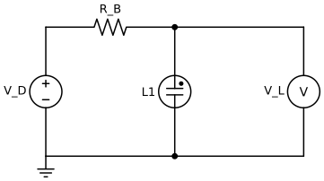

# Circuit and mathematics

**Legend:** V_D: voltage drive; R_B: ballast; L1: neon lamp; V_L: bulb voltage. Light is measured separately by a photodiode. The figure is conceptual: the high-voltage driver and safe measurement front end are not specified.

The input is `V_D = V_bias + G u`, where voltages are in V and u is dimensionless. In a conducting steady state, Kirchhoff's law gives `I_L = (V_D - V_L) / R_B` in A. The neon model uses separate strike and extinction thresholds and a linear lit branch. Lumped capacitance models unmeasured bulb, wiring and probe capacitance; it also introduces circuit memory.

Brightness is modeled as proportional to positive current. Event rate counts ignition crossings. Oscillation is within-step brightness-proxy variation. These are hypotheses, not measured light or evidence of intrinsic plasma memory. The LED is a separate diode model with illustrative low-voltage drive.

The present state predicts the next NARMA-10 target using a linear readout. NMSE is test MSE divided by test-target variance. IPC is a truncated degree-2 held-out estimate with shuffled controls. Physical strike, extinction, LED ratings, source limits and measurement bandwidth require actual components and measurements; see `research/`.
