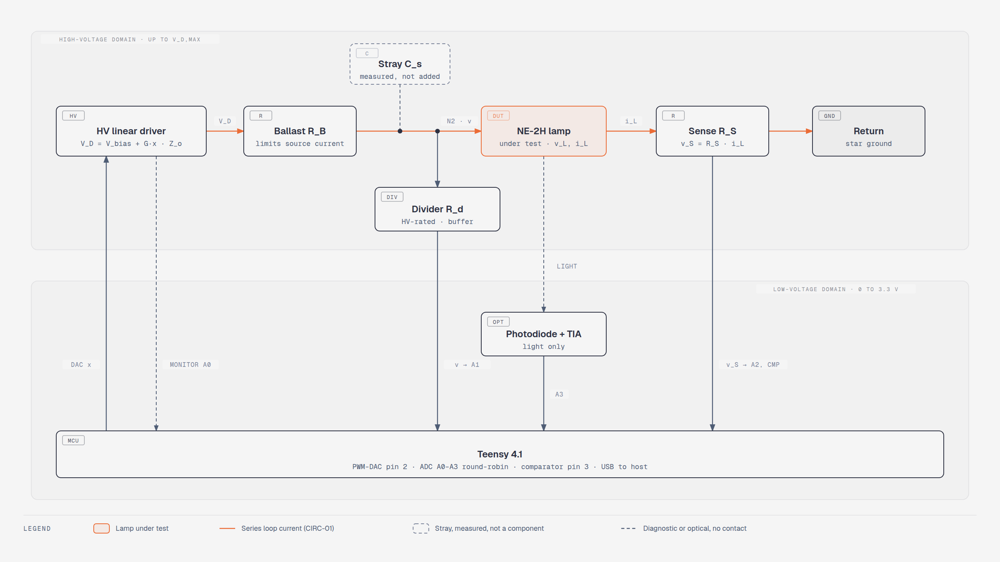
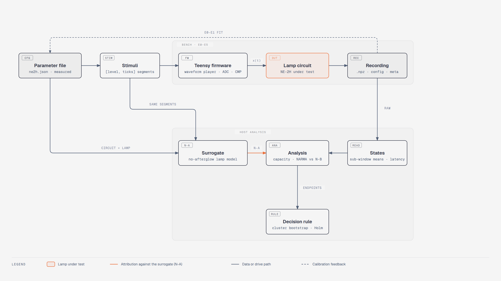

# Minimal NE-2H reservoir: technical description

Updated 2026-11-04. IDs in brackets refer to the project decision log; design basis and sources (§ references) are in the project research notes (both kept local). Labels: **Cited**, **Derived**, **Inferred**, **Unknown**. Figures are in `diagrams/`.

## 1. Claim under test

- **H1 (untested hypothesis):** one DC-biased, input-driven NE-2H-class lamp has *intrinsic* nonlinear fading memory: its measured state depends nonlinearly on past inputs, beyond what the surrounding electronics explain, and responds consistently to repeated inputs.
- **Two nulls (NULL-01):**
  - **N-A, physical:** the measured external network with a lamp surrogate with fixed hysteresis and history-independent ignition delays, but no afterglow kinetics explains the response.
  - **N-B, task:** lamp states give no benchmark gain over input-history baselines.
- **Inferred:** N-A is a dynamic null, not a genuinely static lamp: hysteresis and the pending ignition timer retain state. A separate static I–V/light-map null is weaker. Rejection only challenges the specified validated surrogate, not all external explanations. Two claims are reported separately: *intrinsic lamp memory* (rejects N-A) and *whole-circuit reservoir performance* (rejects N-B). A benchmark win alone is insufficient; a loss to a strong history baseline alone does not disprove memory.
- **Novelty:** no neon or glow-discharge reservoir found in the documented searches (**Cited**, search logs in the local research notes).

## 2. Circuit


*Fig 1.* One series loop (CIRC-01): the lamp and sense resistor carry the same branch current in the ideal sensing model; ballast current also feeds the divider and node capacitance. The capacitance is measured, never intentionally added (CIRC-02). Dashed lines carry no lamp current: the drive monitor is diagnostic only and the photodiode is coupled by light alone (CIRC-03).

| Part | Role | Value |
|---|---|---|
| HV linear driver | V_D = V_bias + G·x, output resistance Z_o | Unknown; characterized in E0 |
| R_B | Ballast: sets the operating point, limits source current | Unknown; from §3.6 |
| NE-2H lamp | Element under test (PART-01: manufacturer open) | CML C2A: 1.9 mA design current, 135 VDC max breakdown in light (**Cited**, research §3) |
| R_S | Low-side current sense: i_L = v_S/R_S | Small, so R_S·i_L ≪ v_L; Unknown |
| C_s | Stray capacitance of lamp, wiring, divider, probe | Measured in E0 |
| R_d | HV-rated divider and buffer for the node voltage v | Unknown |
| Photodiode + TIA | Light, no electrical contact | Pole measured in E0 |
| Teensy 4.1 | 8-bit PWM-DAC (pin 2), 12-bit ADC A0–A3 round-robin, comparator edge timestamps (pin 3) | **Cited**, PJRC; pins 0–3.3 V, not 5 V tolerant |

Why one loop (**Derived**, Thévenin): a second input loop through R_e reduces, for the lamp, to one source behind one resistor,

$$
\begin{aligned}
V_{th}(t) &= \frac{R_e V_{bias} + R_B\, v_a(t)}{R_B + R_e} \\
R_{th} &= R_B \parallel R_e
\end{aligned}
$$

so the lamp cannot tell the two circuits apart, provided source impedances are linear and resistive and terminal voltage and resistance are matched. A resistive DAC connection is possible in principle but requires verified reverse-current tolerance, compliance and protection; a coupling capacitor alone is not a protection design (CIRC-01a).

## 3. Circuit mathematics

**Symbols.** x ∈ [0, 1]: normalized DAC output; V_D [V]: drive; Z_o, R_B, R_d, R_S [Ω]; R_B' = R_B + Z_o; C_s [F]; v [V]: node N2 (lamp anode); i_L [A]: lamp current; v_L = v − R_S·i_L [V]: lamp voltage; V_b [V]: static breakdown; V_m [V], r_on [Ω]: intercept and slope of a linear fit to the measured lit branch; I_x [A]: minimum sustaining current; s ∈ {0, 1}: lamp off/on; τ_drv [s]: driver pole.

### 3.1 Drive

```math
V_{cmd}(x) = V_{bias} + G\,x, \qquad \tau_{drv}\,\frac{dV_D}{dt} = V_{cmd} - V_D
```

A held DAC level applies V_cmd for one step; τ_drv = 0 is an ideal driver. **Inferred:** This is a one-pole approximation, not a general model of the PWM/filter/driver chain. Validate it under load or use a measured multi-pole response. V_D in these equations is the internal Thévenin voltage before the resistive Z_o; the physical driver-terminal monitor reads V_out = V_D − Z_o i_src. Do not substitute V_out while also retaining Z_o in R_B'. Frequency-dependent output impedance requires an extended model.

### 3.2 Node equation (Derived, Kirchhoff's current law at N2)

```math
C_s\,\frac{dv}{dt} = \frac{V_D - v}{R_B'} - \frac{v}{R_d} - s\,\frac{v - V_m}{r_{on} + R_S}
```

### 3.3 Lamp model (model hypothesis)

Hysteretic switch with a strike delay:

$$
\begin{aligned}
\text{off} \to \text{on}&: \ v \text{ rises through } V_b, \text{ strike after } t_d = t_f + t_s, \text{ cancelled if } v < V_b \text{ by then} \\
\text{on} \to \text{off}&: \ i_L = \frac{v - V_m}{r_{on} + R_S} < I_x
\end{aligned}
$$

t_f is the formative delay and t_s the statistical delay. With t_d drawn i.i.d., the lamp has a hysteretic state plus a pending-event timer, but no afterglow kinetics: it is the N-A surrogate lamp. All of V_b, V_m, r_on, I_x and the delay distribution are **Unknown** until E1/E2.

### 3.4 Thévenin view and lit operating point (Derived)

$$
\begin{aligned}
V_{th} &= V_D\,\frac{R_d}{R_B' + R_d}, \qquad R_{th} = R_B' \parallel R_d \\
i_{op} &= \frac{V_{th} - V_m}{R_{th} + R_S + r_{on}} \\
V_x &= V_m + (r_{on} + R_S)\,I_x \qquad \text{(node voltage at extinction)}
\end{aligned}
$$

With a measured lit curve v_L = f(i_L), solve V_th = i_L(R_th + R_S) + f(i_L) instead; linearization of the shunt-capacitor node gives stability iff 1/R_th + 1/(R_S + df/di) > 0, assuming a differentiable, locally invertible memoryless branch and the stated passive external model. This follows from C_s δv_dot = −[1/R_th + 1/(R_S + df/di)] δv. The series-load-line slope criterion alone is insufficient for negative differential resistance; dynamic lamp/driver states require the full Jacobian.

### 3.5 Regimes (REGIME-01, Derived)

| Regime | Condition | Behaviour |
|---|---|---|
| R0 dark | V_th < V_b and i_op < I_x | No discharge; v → V_th with τ = R_th·C_s |
| R1 flashing | V_th > V_b and i_op < I_x | Strike, extinction, recharge: relaxation |
| R2 lit | V_th > V_b and i_op > I_x | Continuous glow; the input modulates i_L, v_L, light |
| latch | V_th < V_b and i_op > I_x | Bistable: state depends on history; violates initial-state forgetting |

Exact strike/holding equalities are boundary cases, not robust operating regimes; at V_th = V_b an initially lower node approaches threshold asymptotically. The development protocol keeps an input range inside one regime (an experimental restriction, not a reservoir theorem), except the R0/R1 edge band adopted for E4 by REGIME-02; the latch band stays excluded.

**R1 flash period with zero delay (Derived):**

$$
\begin{aligned}
T_f &= t_c + t_{on} \qquad (t_d=0) \\
t_c &= R_{th} C_s \ln\frac{V_{th} - V_x}{V_{th} - V_b} \\
t_{on} &= \frac{C_s}{g} \ln\frac{V_b - v_{eq}}{V_x - v_{eq}}, \qquad g = \frac{1}{R_B'} + \frac{1}{R_d} + \frac{1}{r_{on} + R_S}, \qquad v_{eq} = \frac{V_D/R_B' + V_m/(r_{on} + R_S)}{g}
\end{aligned}
$$

**Derived:** For constant drive and delay t_d > 0, ignition occurs at v_ign = V_th − (V_th − V_b) exp[−t_d/(R_th C_s)]. Replace V_b in the on-time numerator by v_ign, then add t_d. These formulas require V_th > V_b > V_x > v_eq and a settled ideal drive. Random delays produce a distribution of periods.

If the corrected charging and discharge times are much shorter than t_d, the flash interval is set by the gas, whose strike delay depends on rest history in laboratory neon tubes (**Cited**: Spasić et al. 2003; Maluckov et al. 2016), although voltage-dependent ignition and external dynamics can still influence it (**Inferred**, to be measured). Removing added capacitance does not establish history dependence.

### 3.6 Current, energy and ratings (SAFE-01, Derived)

$$
\begin{aligned}
i_{src,max} &= \frac{V_{D,max}}{R_B'} \qquad (v \ge 0) \\
R_B' + R_S &\ge \frac{V_{D,max}}{I_{design}} \qquad \text{(conservative continuous bound, } v_L \ge 0) \\
i_{pk} &\approx \frac{v_{ign} - V_m}{r_{on} + R_S} \qquad \text{(actual ignition voltage }v_{ign}\text{)} \\
\Delta E &= \tfrac12 C_s \left(v_{ign}^2 - V_x^2\right) \\
P_{R_B,short} &= \frac{V_{D,max}^2 R_B}{(R_B')^2}
\end{aligned}
$$

The ballast limits the source current only; i_pk is limited by r_on, R_S and lead inductance. The datasheet gives no pulse rating (**Cited** absence), so i_pk is measured on R_S in E1. **Derived:** ΔE is capacitor energy loss, not total lamp pulse energy: the source can also contribute and other resistors dissipate energy. `Config.safety()` instead reports conservative model envelopes using v ≤ V_D,max: peak branch current ≤ max(0, V_D,max − V_m)/(r_on + R_S) and stored capacitor energy ≤ C_s V_D,max²/2. These require positive passive resistances, initial node voltage below that bound and no source overshoot beyond it; they are not hardware guarantees. The legacy `strike_energy_j` field denotes this stored-energy envelope; `acquire.py` refuses lamp stages unless the continuous bound holds.

### 3.7 External memory bound (ATTR-01)

Within one differentiable branch (**Derived**, linearizing §3.2 with g_L = ∂i_L/∂v_L):

```math
\tau = \frac{C_s}{1/R_B' + 1/R_d + g_L/(1+R_S g_L)}
```

For every external element j (DAC/filter, driver, divider/buffer, TIA, anti-alias), the residual one input step after a step change is

```math
\epsilon_j = \frac{|y_j(t_0 + T_{step}) - y_j(\infty)|}{|y_j(\infty) - y_j(t_0)|}, \qquad \epsilon_j = e^{-T_{step}/\tau_j} \ \text{for one pole}
```

measured in E0 (`analyze e0`) and required below a prefixed ε_max. **Derived:** Since δv = δv_L + R_S δi_L, the node sees g_L/(1+R_S g_L), not g_L. Require a positive total conductance for decay.

**Inferred:** Evaluate residuals over every actual sample/sub-window, not just the end of T_step. Include cascaded poles and uncertainty: individual end-of-step limits do not bound the full feature response. A bound limits how much one pole can contribute; it never proves intrinsic memory, which is why N-A exists.

## 4. System pipeline


*Fig 2.* Stimuli play through the Teensy into the lamp circuit; recordings become states (READ-01/02). The analysis tests them against task baselines (N-B) and against the N-A surrogate: the measured circuit with a no-afterglow lamp, driven by the same segments. E0–E1 recordings calibrate the parameter file.

### 4.1 Parameter file

`configs/*.json`: sections `circuit`, `lamp`, `sensors`; every value is `{value, unit, source}` with source ∈ {measured, datasheet, assumed, unknown}. Null exactly when unknown; any calculation that needs an unknown value raises. `ne2h.json` is all unknown except the datasheet design current;

### 4.2 Stimuli and quantization (Derived)

All stimuli are segments [level ℓ, ticks]. For random held input in a level range [ℓ_lo, ℓ_hi] chosen inside one regime:

```math
x_k = \frac{\ell_k}{255}, \qquad u_k = \frac{1}{2}\,\frac{\ell_k - \ell_{lo}}{\ell_{hi} - \ell_{lo}} \in [0, 0.5]
```

Targets are built from the exact applied u_k. Ramps (E1) step ℓ up then down; pulse pairs (E2) are settle → conditioning pulse (or sub-breakdown sham) → rest τ → identical test pulse, in shuffled order.

### 4.3 Firmware timing

One tick = (ocr1a + 1) CPU cycles. Segment i occupies ticks [S_i, S_{i+1}) with S_0 = 0 and S_i = Σ_{j<i} ticks_j; the level changes at the start of tick S_i, before that tick's conversion. Channel c of n is sampled on ticks t with (t − 1) mod n = c, so channels are skewed by one tick each. Flash time = (tick·(ocr1a + 1) + sub)/f_CPU. Alignment is verified in E0 with the drive monitor.

### 4.4 States (READ-01)

For segment k and channel c ∈ {v, v_S, light}, the state is the M sub-window means of the calibrated channel,

```math
X_{k} = \left[\bar y_{c}(k, 1), \dots, \bar y_{c}(k, M)\right]_{c}, \qquad y = \text{gain}_c\,(\text{ADC volts} - \text{offset}_c)
```

Sub-window averaging is linear and disclosed. The drive monitor is never a feature. Summary features (flash count, within-step standard deviation) are nonlinear and only an ablation.

## 5. Analysis mathematics

### 5.1 Readout and NMSE

Features are standardized on fitting rows only: training during selection, train + validation during the final refit. Ridge regression with α chosen on validation from {10⁻⁶, 10⁻⁴, 10⁻², 1}, refit on train + validation, scored once on test:

```math
\mathrm{NMSE} = \frac{\langle (z - \hat z)^2 \rangle_{test}}{\mathrm{Var}_{test}(z)}
```

Splits: washout 10 %, train to 50 %, validation to 70 %, test to the end (VALID-01).

### 5.2 NARMA-10 (Cited: Atiya & Parlos 2000, IEEE Trans. Neural Netw. 11, 697)

```math
y_{k+1} = 0.3\,y_k + 0.05\,y_k \sum_{i=0}^{9} y_{k-i} + 1.5\,u_k u_{k-9} + 0.1
```

X_k predicts y_{k+1}. N-B baselines: the linear input history s_k … s_{k−9} with s = 4u − 1, and the same plus all pairwise products, cross-lag included.

### 5.3 Information processing capacity (Cited: Dambre et al. 2012, Sci. Rep. 2, 514)

With s_k = 4u_k − 1 ∈ [−1, 1] and positive delays d, i, j ≥ 1 only:

$$
\begin{aligned}
z^{(1)}_d[k] &= s_{k-d}, \qquad z^{(2)}_{ii}[k] = \tfrac32 s_{k-i}^2 - \tfrac12, \qquad z^{(2)}_{ij}[k] = s_{k-i}\,s_{k-j}\ (i<j) \\
C[z] &= \max\left(0,\ 1 - \mathrm{NMSE}_{test}(z)\right) \\
\theta &= \max_{\text{shuffles},\,z} C[z_{\text{shuffled }u}], \qquad C[z] \leftarrow 0 \ \text{if} \ C[z] \le \theta
\end{aligned}
$$

Delay 0 is excluded because it measures transduction, not memory. **Cited:** The population bound requires orthogonal targets and infinite-data limits; it is not an exact bound on these finite, regularized, clipped estimates ([Dambre et al. 2012](https://www.nature.com/articles/srep00514)). For quantized uniform levels, center/orthogonalize polynomial targets under the actual input distribution before interpreting the sum as IPC. Until implemented, report these as truncated delayed prediction scores, not a calibrated total capacity.

### 5.4 Consistency

For repeated identical suffixes after different prefixes, per feature c:

$$
\begin{aligned}
\kappa &= 1 - \frac{\langle (a_c - b_c)^2 \rangle}{\tfrac12\left(\mathrm{Var}\,a_c + \mathrm{Var}\,b_c\right)} \\
\rho &= \mathrm{corr}(a_c, b_c)
\end{aligned}
$$

κ is a proposed agreement diagnostic, not a literature-established consistency capacity; it can be negative and is undefined at zero variance. κ sees offset and gain differences that ρ misses (Codex review); ρ is the cited measure (**Cited**: Uchida, McAllister & Roy 2004, PRL 93, 244102).

### 5.5 Attribution test against N-A (ATTR-01)

The surrogate is the measured circuit model (`plasma_rc/sim.py`, §3.2–3.3, i.i.d. delays) driven by the same segments, averaged over k delay draws and read out like the lamp; its states are X̂. For each measured electrical feature j:

$$
\begin{aligned}
B_k &= \left[\hat X_k,\ s_k\right], \qquad A_k = \left[\hat X_k,\ s_k,\ s_{k-1}, \dots, s_{k-D}\right] \\
\Delta &= \overline{\mathrm{NMSE}}\left(B \to X_j\right) - \overline{\mathrm{NMSE}}\left(A \to X_j\right)
\end{aligned}
$$

**Inferred:** Δ is exploratory evidence of surrogate discrepancy, not a calibrated rejection statistic or identification of gas memory. Missing external poles, parameter error and stochastic mismatch can also produce it. Before confirmation, generate independent repeated null datasets over justified parameter/noise uncertainty and run the entire fitting/selection pipeline to obtain a null distribution of Δ. Validate that calibration on held-out null controls, then fix a multiplicity-adjusted rejection threshold and practical effect margin. This calibration is not yet implemented; no intrinsic-memory verdict may be generated from Δ alone. Ground truth in `tests/test_analysis.py`: synthetic hidden memory gives Δ > 0.5; none gives |Δ| < 0.02.

### 5.6 Pulse-pair memory (E2)

Delay per trial: d = first strike in the test pulse − test onset (no strike = censored, kept). Per rest interval τ:

```math
\delta(\tau) = \mathrm{median}\, d_{sham}(\tau) - \mathrm{median}\, d_{real}(\tau)
```

**Cited — implementation:** `memory_effect()` excludes no-strike NaNs from delay medians and correlation. Therefore δ and Spearman’s ρ describe successful strikes only, not censoring-adjusted delay distributions. Report strike fractions alongside them; comparisons can be selection-biased when fractions differ. A confirmatory delay endpoint needs a prespecified censored-time analysis with observation windows and event indicators, or a separately calibrated fixed-window strike-probability endpoint.

The descriptive output includes Spearman's ρ of successful d_real against τ, and the node voltage just before each test pulse for real and sham trials. Unequal pre-test voltages mean the external state, not the gas, may explain δ.

### 5.7 Statistics (VALID-01)

Unit = trial, clustered by bulb (or bulb × session); one paired difference per trial. Cluster bootstrap of the mean of per-bulb means; Holm adjustment over the primary endpoints:

```math
p^{Holm}_{(i)} = \max_{j \le i} \min\left(1,\ (m - j + 1)\,p_{(j)}\right)
```

## 6. Protocol and decision rule

| Stage | Purpose | Outputs |
|---|---|---|
| E0 | Driver, filter, divider, sensors, ADC, comparator on open / resistor / resistor + C dummy loads; LED pulses into the photodiode (LED-01) | ε_j, Z_o, poles, skew, drops, C_s, gains |
| E1 | Per bulb, dark box: slow ramp → V_b bracket, lit-branch fit (V_m, r_on), I_x bound, i_pk on R_S | Surrogate parameters, regime map |
| E2 | Pulse pairs with sham and settling check; fixed-voltage delay separate from ramped strike | δ(τ), strike fraction, censored trials |
| E3 | R2 small-signal step response vs resistor substitute (method: Alonso et al. 2007) | Lit-state timescales (historical µs response is motivation only; the selected NE-2H timescale remains **Unknown**) |
| E4 | T_step per regime from E2/E3 (TIME-01); capacities, consistency, attribution, NARMA vs N-B | Development estimates; δ and repeat counts fixed |
| E5 | Everything frozen; fresh bulbs and sessions | Confirmatory result |

| Outcome | Requires |
|---|---|
| Intrinsic memory supported | Independently validated E2 history effect **or E3 lit-state history effect**, with external-state uncertainty controlled; calibrated rejection of the specified surrogate; positive-delay nonlinear processing and repeatability meeting frozen criteria. Current Δ diagnostic alone is insufficient |
| Neon–circuit reservoir only | Gain over resistor control and N-B, but N-A explains it |
| Negative or inconclusive | Neither E2 nor E3 supports the claim, or attribution remains unresolved, or consistency is too low. Excess external residual makes intrinsic attribution inconclusive, not necessarily whole-circuit computation impossible |

## 7. Safety

Before any hardware step: state V_D,max and the derived bounds of §3.6 from the actual parts; verify the driver's own current limit into a dummy load, resistor voltage and power ratings (R_B, R_d1, monitor divider), clamps on every ADC pin (3.3 V), probe ratings, the star return and a bleed path for stored charge. Never connect the lamp without R_B: "Bulb may shatter and/or circuit may be damaged without external series resistance" (**Cited**, CML datasheet fn 12). Software checks are not interlocks.

## 8. Unknowns

V_b distribution, V_m, r_on, I_x and delay statistics per bulb; C_s; Z_o, τ_drv and sensor poles; R_B, R_S, R_d, V_D,max; DAC choice; ε_max, δ, consistency tolerance; T_step per regime; NE-2H fill pressure and electrode material. Not yet implemented: calibrated attribution-null distribution, censoring-aware confirmatory E2 endpoint, discrete-input orthogonal capacity basis, measured sensor poles inside the surrogate (before E5), an E3 capture path faster than the round-robin ADC, and Richardson bias correction of capacities.

## Review correction status (2026-11-04)

This revision corrects algebra and qualifies inference claims from the earlier design report; conflicting formulas in that historical report are superseded by this technical description. Scientific protocol refinements remain proposals until reviewed. No hardware values or device behavior have been validated by these corrections.
