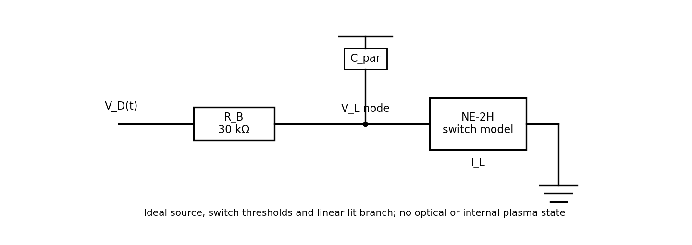
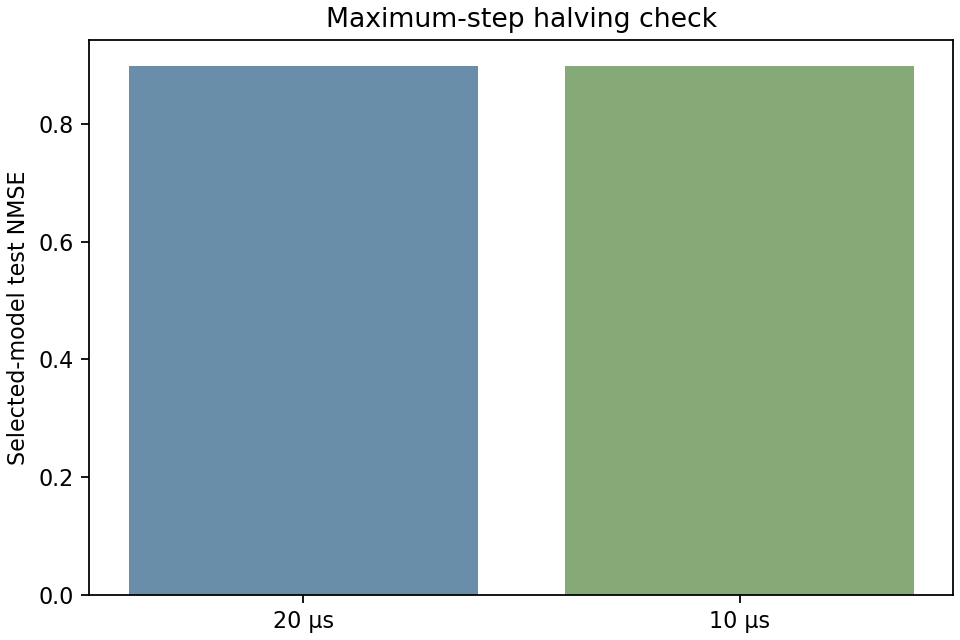
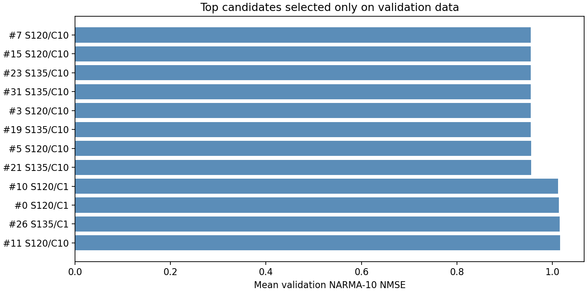
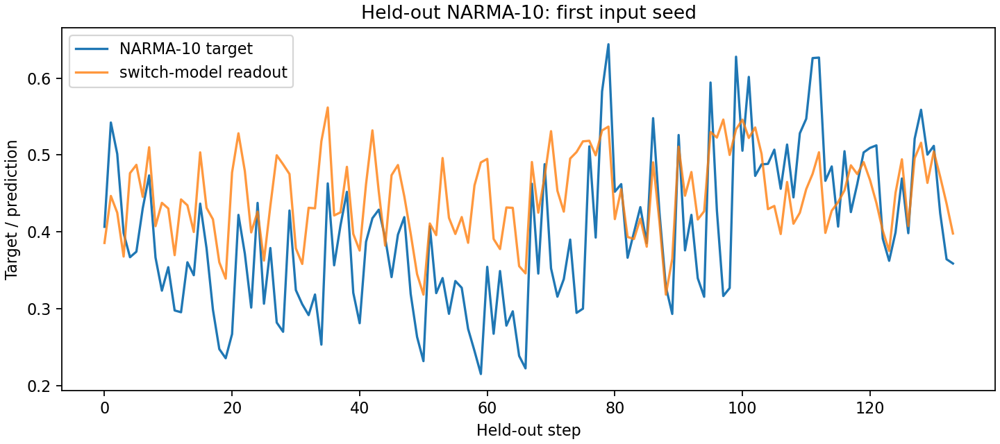
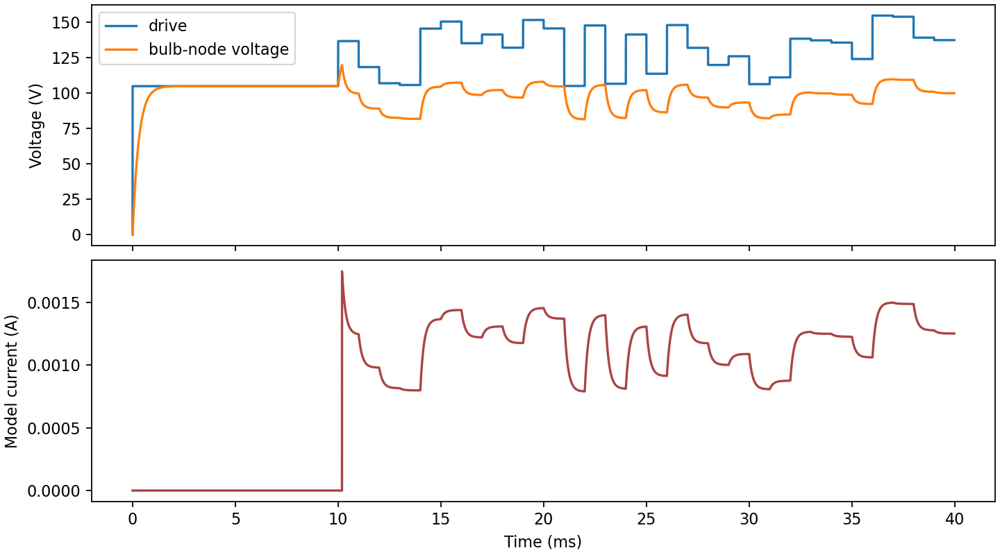
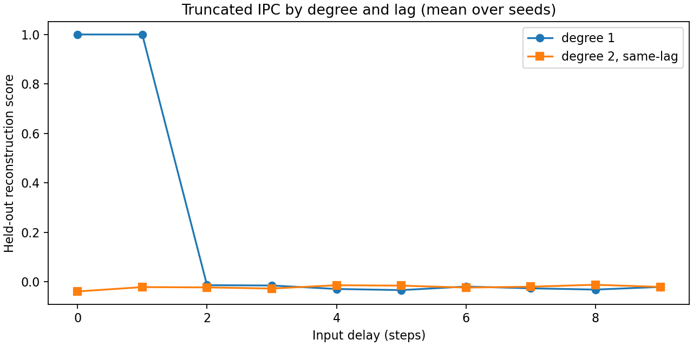
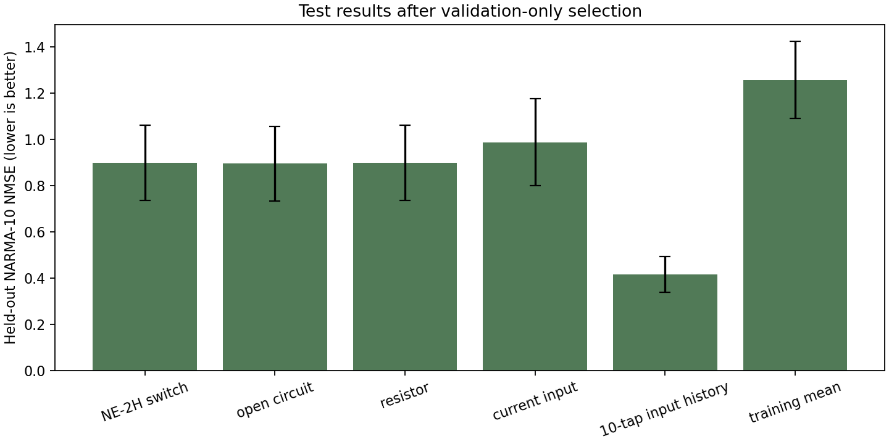
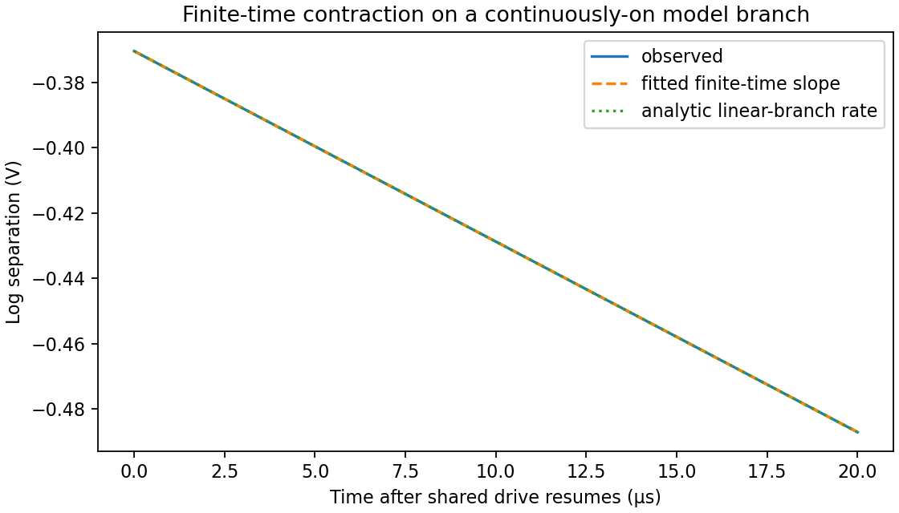

# Exploratory NE-2H-labeled reservoir simulation

**Status:** simulation-only exploratory result, not a physical experiment or calibrated NE-2H model. No measured NE-2H trace or bulb-specific parameter was available. All 32 candidates are assumptions. Results describe the selected model and protocol only.

## 1. Simulation circuit

The simulated topology is an ideal programmable voltage source V_D(t), a series ballast R_B = 30 kΩ, a neon branch whose node voltage V_L and current I_L are observed, and a lumped parallel capacitance C_par. The input mapping is V_D = 105 V + 100 V × u, with u uniformly sampled from [0, 0.5] and held for 1 ms. The model is an instantaneous hysteretic switch plus a linear conducting branch; it has no internal plasma state. Its current is an electrical state feature, **not measured light**.

This conceptual topology uses an ideal drive source, a 30 kΩ ballast, an idealized lamp branch, and parallel capacitance at the lamp node. It is not a hardware schematic; the lamp model does not include physical plasma or optical behavior.

## 2. NE-2H facts and model limitations

The reviewed CML-IT datasheet identifies C2A as NE-2H and lists 1.9 mA design current, 95 VAC / 135 VDC maximum initial breakdown in light, and a 150 V minimum DC circuit voltage for high-brightness lamps. The 150 V value is source-circuit voltage, not bulb strike or maintaining voltage. The datasheet does not provide a typical strike distribution, extinction/holding point, conducting I–V slope, dynamic delay, parasitic capacitance, or optical response. These facts are recorded in [the source review](../../../docs/research/ne2h_model_parameters.md).

For this run, 135 V is used only as one upper-edge strike scenario; 120 V and every extinction, intercept, on-resistance, capacitance, and the 30 kΩ ballast are explicitly exploratory assumptions. They are **not** calibrated device values or a recipe for a physical circuit. The sweep cannot find physically accurate parameters without measurement data. Selecting by NARMA validation error instead finds the best task-performing member of this assumed grid and can overfit that validation protocol.

## 3. Figures and what this simulation can show

The plots show what can be evaluated within this ideal switch model: benchmark prediction, sensitivity to assumed parameters, electrical state trajectories, truncated input reconstruction, timestep sensitivity, and local deterministic contraction. They do not demonstrate that a real NE-2H bulb is a viable reservoir. In particular, omitted optical and internal discharge dynamics cannot appear in the model's results.

The selected model's held-out NMSE is nearly unchanged when the maximum integration step is halved. This checks numerical sensitivity for this run, not the physical accuracy of the circuit model.

The 12 lowest validation-NMSE candidates from the assumed parameter grid are shown; lower is better. These scores choose a task-performing assumption, not a physically calibrated bulb parameter set.

Target and readout prediction over the held-out NARMA-10 segment for the first input seed. This single-seed trace illustrates prediction quality; the summary table reports results across all five seeds.

Simulated drive, lamp-node voltage, and model current over the displayed initial time window. These are electrical outputs of the idealized model, not measured signals from a bulb.

Held-out input-reconstruction scores across delays for degree-1 and same-delay degree-2 targets. The plotted view is truncated and does not include every cross-delay target used in the reported IPC total.

Mean held-out NARMA-10 NMSE and standard deviation across seeds for the selected switch model and controls; lower is better. The switch model does not outperform the open control, and the input-history baseline is substantially better.

Log voltage separation for two model trajectories on a continuously-on RC branch, compared with fitted and analytic slopes. This conditional model diagnostic is not a physical or general hybrid-system Lyapunov exponent.

## 4. Protocol and selected scenario

The experiment used 5 input seeds and 450 steps per seed. The chronological ranges are washout/training (45, 225), validation (225, 315), and held-out test (315, 449). Grid candidates and ridge alpha were selected using only mean validation NARMA-10 NMSE; the test split was evaluated once for the selected candidate. Maximum transient step was 20 µs, with a second run at half that step.

Selected **validation-best assumptions**: strike = 120 V, extinction = 60 V, conducting intercept = 50 V, on-resistance = 40 kΩ, C_par = 10 nF, readout alpha = 10. These values are selected for benchmark performance, not physical accuracy.

## 5. Results

### NARMA-10

NMSE is test MSE divided by test-target variance; lower is better. Values below are mean ± standard deviation across input seeds (not confidence intervals).

| Readout state/control | Mean test NMSE | SD |
|---|---:|---:|
| NE-2H-labeled switch model | 0.8978 | 0.1632 |
| open | 0.8942 | 0.1616 |
| resistor | 0.8981 | 0.1633 |
| current input | 0.9862 | 0.1882 |
| 10 tap input history | 0.4151 | 0.0763 |
| training mean | 1.2566 | 0.1676 |

The direct input and 10-tap input-history baselines help establish task difficulty. The open-circuit and resistor controls reveal whether the switch's electrical nonlinearity adds useful information within this model. A lower score for one simulated candidate is not evidence that an actual lamp computes; no real-bulb or calibrated optical control was tested.

### IPC and state dimension

The reported IPC is deliberately truncated: held-out degree-1 and degree-2 Legendre targets for delays 0–9, with shuffled-input maximum cutoffs (n=20). Mean linear capacity = **2.0000**; degree-2 capacity including cross-delay products = **0.0000**; truncated total = **2.0000**. This is not complete theoretical IPC. The IPC plot shows same-delay degree-2 targets for clarity; all cross-delay targets and their per-seed scores are retained in `summary.json`. The effective rank of the eight sampled voltage/current features is 1.260; it is a descriptive finite-sample feature statistic, not the physical state dimension.

### Electrical regime

At the declared 1 µA numerical on-threshold, the best model was conducting for a mean **0.976** of the simulated time and had **1.0** off-to-on transitions per input sequence. These describe the switch code under the chosen drive and threshold; they are not measured lamp ignition rates.

### Stability-related diagnostic

Status: **estimated for the deterministic, continuously-on one-capacitor model segment**. The measured quantity, when estimated, is a finite-time voltage-separation slope on the assumed deterministic continuously-on linear RC branch, compared against that branch's analytic rate. This one-capacitor model diagnostic is **not a physical Lyapunov exponent**, does not cover switching/stochastic discharge dynamics, and cannot be transferred to a real bulb.

### Numerical sensitivity

Halving the maximum timestep changed selected-model mean test NMSE from 0.8978 to 0.8978; mean RMS bulb-voltage difference between coarse and fine trajectories was 0.00336408 V. This is a basic timestep sensitivity check, not validation of the model equations.

## 6. Conclusion and what is needed next

This simulation can demonstrate that a specified hysteretic-switch circuit produces benchmark states and can quantify those states' task performance **conditional on the assumptions**. It cannot answer whether a physical NE-2H provides useful nonlinear memory, whether this parameter set matches a bulb, or whether the optical signal has the modeled properties. The decisive next step for physical inference is identifying the actual bulb and recording calibrated, synchronized applied drive, bulb voltage, and lamp current (plus calibrated light if optical readout is studied), with repeated trials and a held-out condition. Until then, call this a model-based NARMA parameter search, not NE-2H calibration or a physical experiment.

## Reproducibility

`summary.json` stores all candidate validation scores, parameters, seeds, splits, software version, IPC results, and numerical checks. Raw traces and sampled states for the selected model are under `best/`; input vectors are saved at the report root. Non-selected candidate traces are not retained, but all candidate settings and scores are. The grid was selected on validation scores only. Re-run with `python -m experiments.neon_ne2h OUTPUT`.
